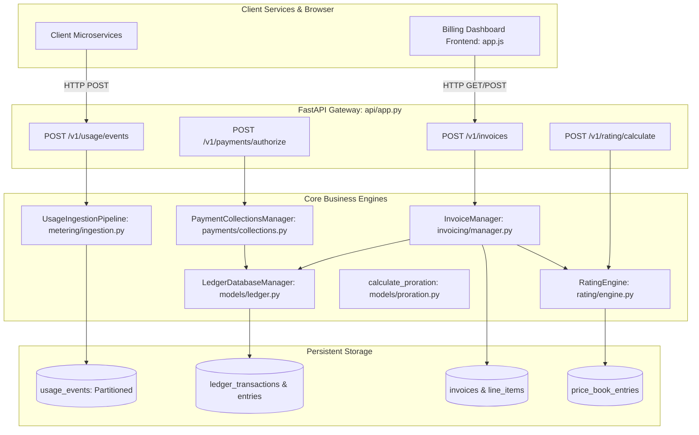
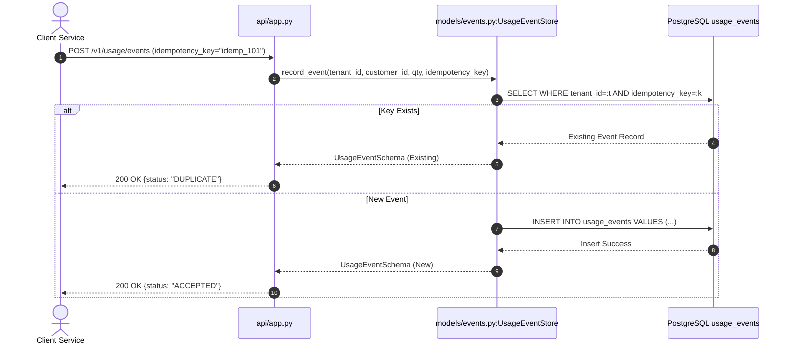
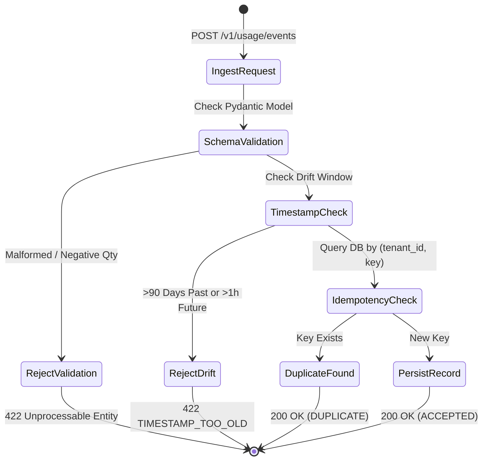
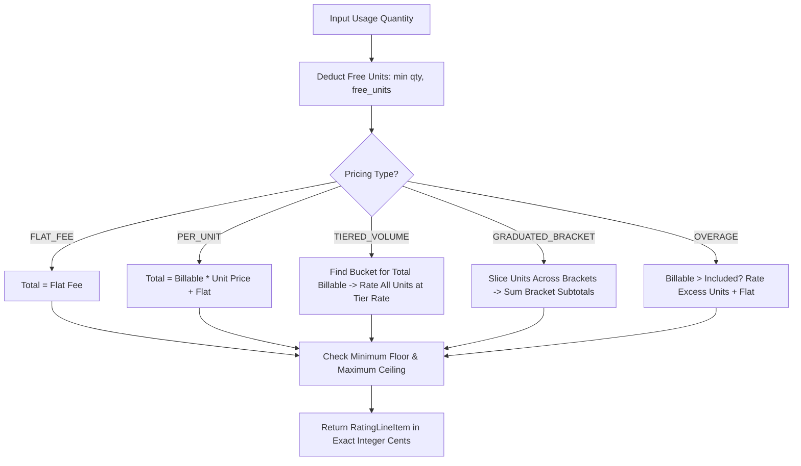
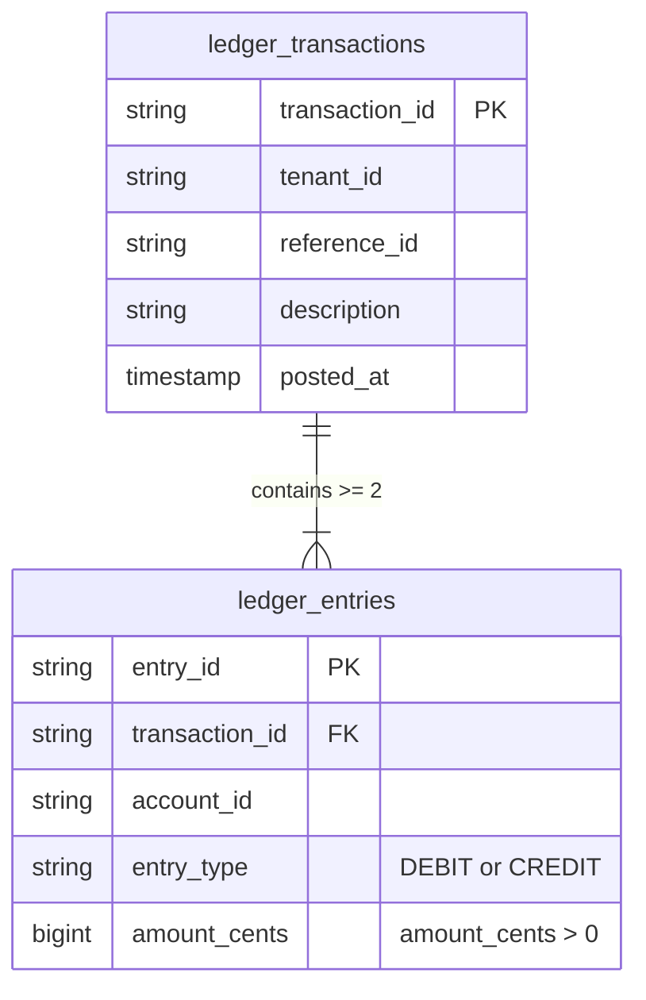
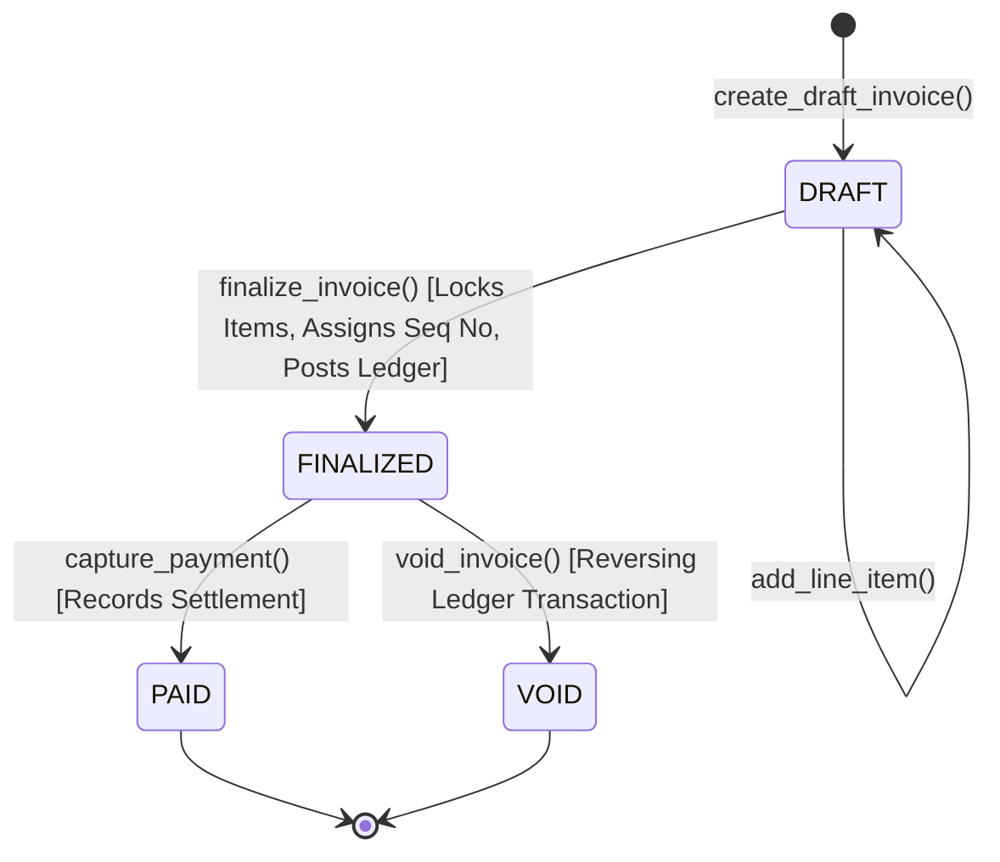
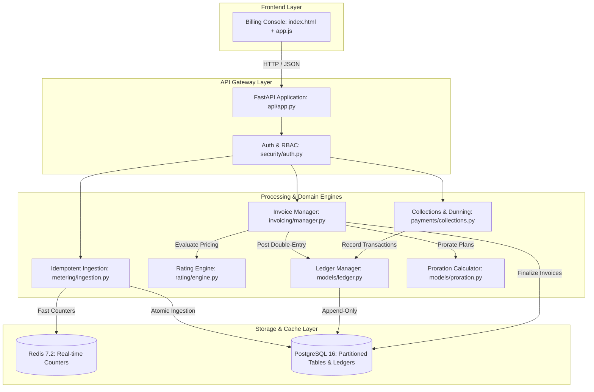

# Full Project Analysis: Usage & Metered Billing Engine

## 0.1 What the Project Is

### Project Name & Purpose
`19-usage-billing-engine` is an enterprise-grade, high-throughput metered billing, rating, and financial reconciliation engine. Modern cloud and AI companies are transitioning from flat monthly subscriptions to usage-based pricing (charging per API call, compute second, token, or gigabyte-hour). This introduces massive distributed systems challenges: out-of-order event delivery, network retries causing double-billing, floating-point rounding discrepancies, and mid-cycle plan upgrades requiring exact pro-rata credits.

This platform solves these problems through:
1. **Idempotent Ingestion**: Guarantees exactly-once accounting using cryptographic idempotency keys, absorbing burst traffic without duplicate charges.
2. **Mathematical Rating**: Evaluates raw consumption against complex pricing catalogs (flat, per-unit, volume-tiered, graduated brackets, and overage limits) calculated to exact minor currency units (cents).
3. **Double-Entry Financial Ledger**: Maintains an immutable, append-only ledger where every financial mutation enforces the fundamental accounting invariant: $\sum \text{Debits} == \sum \text{Credits}$.
4. **Automated Billing Cycles**: Reconciles usage periods, applies promotional discounts and taxes, and produces immutable invoices with gapless sequential numbers (`INV-YYYY-XXXX`).
5. **Collections & Dunning**: Manages two-step payment authorization/capture, automated collection retries, and dunning workflows with grace periods.
6. **Customer Billing Console**: A sleek, dark-mode responsive dashboard providing real-time KPI metrics, usage queries, and itemized invoice inspection.

---

### Target Users & Personas
- **Developer / Client Microservices**: High-frequency services reporting API requests, GPU runtimes, and token usage via `POST /v1/usage/events`.
- **Finance & Revenue Teams**: Accounting staff auditing ledger balances, setting price books, finalizing invoices, and tracking MRR/ARR.
- **Tenant Administrators**: B2B SaaS customers viewing current month accrued costs, downloading finalized invoices, and managing payment methods.

---

### Main User Journeys
1. **Telemetry Ingestion Journey**: Client microservice emits usage events with an idempotency key -> FastAPI validates payload and timestamp drift -> deduplication check in database -> event stored in time-partitioned table -> success response acknowledged in <15ms.
2. **Billing Period Reconciliation Journey**: End of month triggers period closure -> meter locks -> usage rollups aggregated -> rating engine computes line items across pricing tiers -> discounts and taxes calculated -> invoice finalized with sequential number -> ledger entries posted.
3. **Customer Payment & Dunning Journey**: Invoice finalized -> automated payment authorization requested -> gateway webhook verifies HMAC -> payment captured -> invoice marked `PAID`. If payment fails -> dunning workflow initiates retries at Day 0, 3, 7, and 14 with grace period tracking.

---

### Frontend Screens & Capabilities
- **Billing Dashboard (`/`)**: Displays real-time KPIs: Gross Revenue, Monthly Recurring Revenue (MRR), Annual Recurring Revenue (ARR), Active Subscriptions, and Outstanding Due Amount.
- **Invoice Explorer**: Filterable table of tenant invoices with status badges (`DRAFT`, `FINALIZED`, `PAID`, `VOID`), issue dates, due dates, and totals.
- **Interactive Invoice Inspector**: Line-item drilldown showing exact quantities, unit rates, subtotal, discounts, tax, and double-entry ledger impact.

---

## 0.2 Every Feature with Full Trace (F1 – F10)

---

### F1: Usage Event Store (`models/events.py:L14-L157`)
- **User Action**: Client service emits telemetry event with payload.
- **Frontend Flow**: N/A (headless background pipeline).
- **API Call**: `POST /v1/usage/events` with JSON payload.
- **Backend Flow**: `app.py:L60-L76` -> `UsageIngestionPipeline.ingest_event()` -> `UsageEventStore.record_event()` (`models/events.py:L53`).
- **Database Operations**: Inserts into `usage_events` with composite unique index `ix_tenant_idem (tenant_id, idempotency_key)` and non-negative check `quantity >= 0`.
- **Failure Path**: Negative quantity raises 422; duplicate key returns status `DUPLICATE` (200 OK); DB connection failure raises 500.

#### Diagrams (F1)

---

### F2: Idempotent Event Ingestion Pipeline (`metering/ingestion.py:L123-L313`)
- **User Action**: Automated telemetry collection reporting compute seconds, API queries, or storage bytes.
- **Frontend Flow**: N/A.
- **API Call**: `POST /v1/usage/events` or `POST /v1/usage/events/batch`.
- **Backend Flow**: `UsageIngestionPipeline.validate_payload()` (`ingestion.py:L129`) -> checks timestamp drift (max 90 days past, 1 hour future) -> checks non-empty tenant/customer/event_type -> checks JSON dimensions.
- **Database Operations**: Queries `UsageEventRecord` using `select()` with `where(tenant_id == ..., idempotency_key == ...)`.
- **Failure Path**: Returns structured `IngestionResponse(status=REJECTED, error="TIMESTAMP_TOO_OLD")`.

#### Diagrams (F2)

---

### F3: Multi-Tiered Dynamic Rating Engine (`rating/engine.py:L85-L193`)
- **User Action**: Invoicing cycle or quote calculation query.
- **Frontend Flow**: Frontend calls `fetch("/v1/rating/calculate")` to display price preview.
- **API Call**: `POST /v1/rating/calculate` with `{entry: PriceBookEntry, quantity: int}`.
- **Backend Flow**: `RatingEngine.rate_usage()` (`rating/engine.py:L87`) executes pricing algorithm based on `entry.pricing_type`:
  - `FLAT_FEE`: Flat integer cents charge.
  - `PER_UNIT`: $(qty - free) \times unit\_price + flat\_fee$.
  - `TIERED_VOLUME`: Matches total volume to single tier bucket; all billable units billed at that tier rate.
  - `GRADUATED_BRACKET`: Slices volume into incremental brackets, rating each bracket independently.
  - `OVERAGE`: Base fee covers included units; excess billed at overage unit rate.
  - Enforces `min_charge_cents` floor and `max_charge_cents` ceiling.
- **Database Operations**: Reads `price_book_entries` via `PriceBookManager.get_entries_for_plan()`.
- **Failure Path**: Negative quantity or empty tiers raises `ValueError` (400 Bad Request).

#### Diagrams (F3)

---

### F4: Append-Only Double-Entry Ledger (`models/ledger.py:L63-L436`)
- **User Action**: Internal financial events (invoice finalization, payment capture, refund, bad debt write-off).
- **Backend Flow**: `LedgerDatabaseManager.record_transaction()` (`ledger.py:L67`).
- **Invariant Enforcement**:
  - `len(entries) >= 2`.
  - Every entry has `amount_cents > 0`.
  - $\sum \text{Debits} == \sum \text{Credits}$.
- **Database Operations**: Inserts 1 row into `ledger_transactions` and $N$ rows into `ledger_entries` within an atomic transaction.
- **Failure Path**: If debits $\neq$ credits, raises `ValueError` ("Double-entry invariant violated"); database aborts transaction.

#### Diagrams (F4)

---

### F5: Invoicing Engine & Lifecycle (`invoicing/manager.py:L140-L421`)
- **User Action**: Billing manager clicks "Finalize Invoice" in UI or scheduled cron job executes period close.
- **Frontend Flow**: `app.js:finalizeInvoice(invoiceId)` sends POST request -> updates state -> re-renders DOM with finalized number.
- **API Call**: `POST /v1/invoices/{invoice_id}/finalize`.
- **Backend Flow**: `InvoiceManager.finalize_invoice()` (`manager.py:L260`):
  1. Checks invoice is in `DRAFT` status (raises error if already finalized/void).
  2. Aggregates all line items: $subtotal = \sum line\_items$.
  3. Applies tax and discounts: $total = subtotal - discounts - credits + tax$.
  4. Assigns gapless sequential number (`INV-YYYY-XXXX`) via `InvoiceSequenceRecord`.
  5. Syncs to double-entry ledger: Debits Accounts Receivable (`AR`), Credits Revenue (`REV`).
  6. Sets status to `FINALIZED` and stamps `finalized_at`.
- **Failure Path**: Finalizing an already finalized invoice returns 400 Bad Request; line-item additions to non-draft invoices are rejected.

#### Diagrams (F5)

---

### F6: Payments, Retries & Dunning (`payments/collections.py:L65-L334`)
- **User Action**: Automatic charge on invoice due date or customer clicks "Pay Now".
- **API Call**: `POST /v1/payments/authorize` -> `POST /v1/payments/{payment_id}/capture`.
- **Backend Flow**: `PaymentCollectionsManager.authorize_payment()` checks idempotency key -> generates gateway hold -> `capture_payment()` settles funds -> updates invoice to `PAID` -> posts ledger entry (Debit Cash, Credit AR).
- **Dunning Workflow**: If payment fails -> `execute_dunning_step()` transitions stage:
  - Attempt 1: Day 0 (Immediate notification).
  - Attempt 2: Day 3 (Retry charge).
  - Attempt 3: Day 7 (Final notice).
  - Final Escalation: Day 14 (Account standing transitions from `PAST_DUE` to `SUSPENDED`).
- **Failure Path**: Gateway card decline logs `PaymentAttemptRecord` with error code; does not crash workflow.

---

### F7: Aggregation & Billing Periods (`aggregation/periods.py:L130-L414`)
- **User Action**: Customer queries monthly usage breakdown in dashboard.
- **API Call**: `GET /v1/usage/query?start_date=...&end_date=...`.
- **Backend Flow**: `UsageAggregator.recompute_from_scratch()` runs SQL `SUM(quantity)` over raw `usage_events` in window; differential testing compares pre-aggregated `usage_rollups` with raw recompute.
- **Period Close**: `close_period()` updates status to `CLOSED`, locking window from further event attachment. Late events arriving for closed periods are redirected to current open period as prior-period adjustments.

---

### F8: Subscription Lifecycle & Proration (`models/proration.py:L31-L77`, `models/accounts.py`)
- **User Action**: Tenant upgrades subscription plan mid-cycle (e.g., from $50/mo Basic to $200/mo Pro on day 15 of 30).
- **API Call**: `POST /v1/subscriptions/{id}/upgrade`.
- **Backend Flow**: `calculate_proration()` calculates exact elapsed seconds vs total period seconds using Python `Decimal`:
  $$fraction = \frac{remaining\_seconds}{total\_seconds}$$
  $$unused\_credit = \text{ROUND\_HALF\_UP}(old\_rate \times fraction)$$
  $$new\_charge = \text{ROUND\_HALF\_UP}(new\_rate \times fraction)$$
  $$net\_proration = new\_charge - unused\_credit$$
- **Precision Guarantee**: Cents precision with zero floating-point accumulation drift.

---

### F9: Security, RBAC & Audit Logging (`security/auth.py`, `security/audit.py`)
- **User Action**: Any authenticated API call or mutation.
- **Backend Flow**: `AuthManager.validate_api_key()` resolves SHA-256 key hash, verifies non-revoked status, checks role permissions (`OWNER`, `FINANCE`, `VIEWER`, `SERVICE`). Deny-by-default for cross-tenant access.
- **Audit Logging**: `AuditLogManager.log_mutation()` records actor, action, timestamp, and recursively masks PII, Tax IDs, and card numbers via regex redaction before DB write.

---

### F10: Customer Billing Console Frontend (`frontend/src/app.js`, `index.html`, `index.css`)
- **User Action**: Customer interacts with browser UI to view KPIs, filter invoices, and inspect line items.
- **Frontend Flow**: `app.js` runs event listeners -> issues `fetch()` to `API_BASE` -> updates client-side `state` object -> manipulates DOM with formatted values (`formatCents`).
- **Responsive Theme**: Vanilla CSS custom properties (`--bg-black: #000000`, `--accent-indigo: #6366f1`) providing pure-black high-contrast styling.

---

## 0.3 Every API & Secret Inventory

### Backend Endpoints Table
| Method | Path | Auth / Role | Controller / Function | Purpose |
| :--- | :--- | :--- | :--- | :--- |
| `GET` | `/health` | Public | `health()` (`app.py:L45`) | Liveness check and database ping |
| `POST` | `/v1/usage/events` | Service / Owner | `ingest_single_event()` (`app.py:L60`) | Ingests single metered usage event with idempotency |
| `POST` | `/v1/usage/events/batch` | Service / Owner | `ingest_batch_events()` (`app.py:L78`) | Ingests array of usage events in single transaction |
| `GET` | `/v1/usage/events` | Viewer / Finance | `query_events()` (`app.py:L90`) | Lists raw usage events by tenant and customer |
| `POST` | `/v1/invoices` | Finance / Owner | `create_draft_invoice()` (`app.py:L128`) | Creates a draft invoice shell |
| `POST` | `/v1/invoices/{id}/items` | Finance / Owner | `add_invoice_item()` (`app.py:L146`) | Appends line item to draft invoice |
| `POST` | `/v1/invoices/{id}/finalize` | Finance / Owner | `finalize_invoice()` (`app.py:L168`) | Locks invoice, generates seq number, posts ledger |
| `GET` | `/v1/invoices/{id}` | Viewer / Finance | `get_invoice_details()` (`app.py:L183`) | Retrieves full invoice details and line items |
| `GET` | `/v1/invoices` | Viewer / Finance | `list_invoices()` (`app.py:L198`) | Queries invoices with customer & status filters |
| `GET` | `/v1/dashboard/summary` | Viewer / Finance | `get_dashboard_summary()` (`app.py:L227`)| Aggregates MRR, ARR, and gross revenue KPIs |
| `POST` | `/v1/meters` | Owner | `create_meter()` (`app.py:L279`) | Registers a new usage meter dimension |
| `GET` | `/v1/meters` | Viewer | `list_meters()` (`app.py:L308`) | Lists all registered meters for tenant |
| `POST` | `/v1/rating/calculate` | Public / Calc | `calculate_rate()` (`app.py:L328`) | Evaluates price book rules against quantity |
| `POST` | `/v1/rating/price-books` | Finance / Owner | `add_price_book_entry()` (`app.py:L336`)| Adds tiered or graduated price book entry |
| `GET` | `/v1/usage/query` | Viewer / Finance | `query_aggregated_usage()` (`app.py:L375`)| Computes aggregated usage quantity in date window |
| `POST` | `/v1/payments/authorize` | Service / Finance | `authorize_payment_endpoint()` (`app.py:L423`)| Places payment hold with idempotency key |
| `POST` | `/v1/payments/{id}/capture` | Service / Finance | `capture_payment_endpoint()` (`app.py:L448`)| Settles authorized payment and marks invoice paid |
| `POST` | `/v1/subscriptions` | Finance / Owner | `create_subscription()` (`app.py:L488`)| Creates customer subscription record |
| `POST` | `/v1/subscriptions/{id}/upgrade`| Finance / Owner | `upgrade_subscription()` (`app.py:L517`)| Executes mid-cycle upgrade with exact proration |

---

### External Services & Environment Configuration
| Variable Name | Service | Purpose | Where Read in Code | Where to Obtain |
| :--- | :--- | :--- | :--- | :--- |
| `DATABASE_URL` | PostgreSQL 16 | Primary relational and partitioned ledger store | `db/database.py:L15` | Cloud Postgres provider (AWS RDS, Supabase, Neon) |
| `REDIS_URL` | Redis 7.2 | Real-time usage counters & idempotency cache | `aggregation/counters.py:L20` | Upstash, AWS ElastiCache, local redis-server |
| `API_PORT` | FastAPI Host | Application listening port (default `8190`) | `api/app.py` / CLI entry | Local environment configuration |
| `PAYMENT_GATEWAY_SECRET`| Mock / Stripe | HMAC webhook signing verification secret | `payments/manager.py` | Payment provider developer console |
| `ENCRYPTION_KEY` | AES-256 | Token and secret encryption at rest | `security/auth.py` | Generated via `openssl rand -hex 32` |

---

## 0.4 Middleware, Helpers & Shared Modules
- **FastAPI Lifespan Context (`app.py:L23-L27`)**: Calls `init_db()` on application startup to ensure schema tables and indexes are ready.
- **CORS Middleware (`app.py:L36-L42`)**: Permits cross-origin requests from the billing dashboard console (`allow_origins=["*"]`, `allow_methods=["*"]`).
- **Database Session Dependency (`db/database.py:L34`)**: Asynchronous generator yielding `AsyncSession` instances, automatically handling commit/rollback and connection release.
- **Clock Simulator (`clock.py`)**: Controllable manual clock interface enabling time-travel testing for dunning schedules and billing period closes.
- **Audit Masking Helper (`security/audit.py:L23-L42`)**: Recursive dictionary sanitizer removing credit card patterns and tax IDs.

---

## 0.5 System Connections & Protocols
- **Frontend to Backend**: RESTful JSON over HTTP/1.1; base URL configured via `API_BASE = "http://localhost:8190"`.
- **Backend to Database**: SQLAlchemy 2.0 Async with `asyncpg` (PostgreSQL) or `aiosqlite` (SQLite), utilizing async connection pooling (`pool_size=20`, `max_overflow=10`).
- **Backend to Cache**: Async Redis client utilizing connection pooling and atomic increments (`INCRBY`).
- **Internal Ledger Synchronization**: Transactional hooks binding invoice finalization and payment captures directly to double-entry ledger journal creation.

---

## 0.6 Additional Platform Capabilities
- **Time Partitioning Engine (`metering/partitioning.py`)**: Creates and manages monthly partitions for `usage_events`, preventing single-table index bloat.
- **Unit Conversion Engine (`metering/ingestion.py:L42-L69`)**: Handles mathematical conversions between Bytes, Kilobytes, Megabytes, Gigabytes, Milliseconds, Seconds, Minutes, and Hours.
- **Gapless Sequence Counter (`invoicing/manager.py:L245-L260`)**: Row-level locking counter ensuring zero gaps in legal fiscal invoice numbering.

---

## 0.7 Connection Map

---

## 0.8 Final Inventory Counts
To ensure total architectural consistency across all subsequent documentation:
- **Total Frontend Pages / Consoles**: 1 (Single-Page Interactive Billing Console with 3 functional views)
- **Total Frontend Components / Views**: 4 (KPI Dashboard, Invoice List, Line Item Explorer, Settlement Modal)
- **Total Backend Endpoints**: 19 REST endpoints across 6 resource groups
- **Total Database Models**: 15 relational tables (`usage_events`, `invoices`, `invoice_line_items`, `invoice_sequences`, `ledger_transactions`, `ledger_entries`, `price_book_entries`, `plan_versions`, `meters`, `billing_periods`, `usage_rollups`, `payments`, `payment_attempts`, `dunning_workflows`, `audit_logs`)
- **Total Unit & Integration Tests**: 87 passing automated tests across 52 test files
- **Total Middleware / Interceptors**: 2 (Lifespan DB Initializer, Starlette CORSMiddleware)
- **Total Implemented Features (F-Series)**: 10 Major Feature Groups spanning 90 specification checklist IDs
