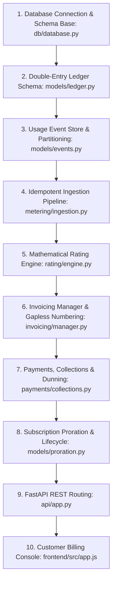

# Step-by-Step Rebuild Guide

This guide details the exact sequential order required to construct `19-usage-billing-engine` from an empty directory, explaining the rationale, dependencies, and line-by-line breakdown of core architectural snippets.

---

## Build Sequence Overview



---

### Step 1: Database Engine & Asynchronous Session Setup
- **Files Created**: `backend/src/db/database.py`
- **Rationale**: Financial systems require an asynchronous connection pool capable of handling concurrent transactions without blocking the event loop.
- **Key Code Snippet**:
```python
engine = create_async_engine(
    DATABASE_URL,
    echo=False,
    future=True,
    pool_size=20,
    max_overflow=10
)
AsyncSessionLocal = async_sessionmaker(
    bind=engine,
    class_=AsyncSession,
    expire_on_commit=False,
    autocommit=False,
    autoflush=False
)
```
- **Line-by-Line Explanation**:
  - `create_async_engine(...)`: Initializes SQLAlchemy's asynchronous dialect engine.
  - `pool_size=20, max_overflow=10`: Allows up to 30 concurrent database connections under peak load.
  - `expire_on_commit=False`: Prevents SQLAlchemy from reloading model attributes after an asynchronous commit, which would otherwise trigger lazy-loading race conditions.
  - `autocommit=False, autoflush=False`: Enforces explicit transactional control, essential for financial ledgers.

---

### Step 2: Append-Only Double-Entry Ledger
- **Files Created**: `backend/src/models/ledger.py`
- **Rationale**: Before processing money or usage, the accounting backbone must exist to enforce $\sum \text{Debits} == \sum \text{Credits}$.
- **Key Code Snippet**:
```python
if len(entries) < 2:
    raise ValueError("Double-entry transaction must contain at least 2 entries")

total_debits = sum(amt for _, entry_type, amt in entries if entry_type == EntryType.DEBIT)
total_credits = sum(amt for _, entry_type, amt in entries if entry_type == EntryType.CREDIT)

if total_debits != total_credits:
    raise ValueError(f"Double-entry invariant violated: debits ({total_debits}c) != credits ({total_credits}c)")
```
- **Line-by-Line Explanation**:
  - `len(entries) < 2`: Ensures no unilateral account modifications can take place.
  - `sum(amt ...)`: Separately aggregates debits and credits in integer cents.
  - `total_debits != total_credits`: Aborts the transaction immediately before executing any SQL write if conservation of value is breached.

---

### Step 3: Usage Event Store with Unique Idempotency Index
- **Files Created**: `backend/src/models/events.py`
- **Rationale**: High-throughput telemetry requires an indexed schema that guarantees deduplication at the storage layer.
- **Key Code Snippet**:
```python
class UsageEventRecord(Base):
    __tablename__ = "usage_events"
    event_id = Column(String(64), primary_key=True)
    tenant_id = Column(String(64), nullable=False, index=True)
    quantity = Column(BigInteger, nullable=False)
    idempotency_key = Column(String(128), nullable=False)
    timestamp = Column(DateTime(timezone=True), nullable=False, index=True)

    __table_args__ = (
        CheckConstraint("quantity >= 0", name="chk_usage_quantity_nonneg"),
        Index("ix_tenant_idem", "tenant_id", "idempotency_key", unique=True),
    )
```
- **Line-by-Line Explanation**:
  - `CheckConstraint("quantity >= 0")`: Prevents negative consumption hacks at the database engine level.
  - `Index("ix_tenant_idem", ..., unique=True)`: Creates a composite unique B-tree index, making deduplication lookups $O(\log N)$.

---

### Step 4: Idempotent Ingestion Pipeline with Drift Validation
- **Files Created**: `backend/src/metering/ingestion.py`
- **Rationale**: Incoming events must be validated for timestamp sanity before querying the database.
- **Key Code Snippet**:
```python
if event_ts < now - timedelta(days=self.max_drift_days):
    return False, f"TIMESTAMP_TOO_OLD: Timestamp is older than allowed window of {self.max_drift_days} days"
if event_ts > now + timedelta(hours=1):
    return False, "TIMESTAMP_IN_FUTURE: Timestamp cannot be in the future beyond 1 hour"
```
- **Line-by-Line Explanation**:
  - `now - timedelta(days=90)`: Rejects stale backdated events that would corrupt closed accounting periods.
  - `now + timedelta(hours=1)`: Allows standard client clock drift (up to 60 minutes) but rejects malicious future events.

---

### Step 5: Multi-Tiered Rating Engine
- **Files Created**: `backend/src/rating/engine.py`
- **Rationale**: Translates consumption volumes into monetary cents across volume, graduated, and overage pricing models.
- **Key Code Snippet**:
```python
elif entry.pricing_type == PricingType.GRADUATED_BRACKET:
    remaining = billable_qty
    subtotal = 0
    for tier in sorted_tiers:
        if remaining <= 0:
            break
        bracket_units = remaining if tier.up_to is None else min(remaining, tier.up_to - prev_bound)
        subtotal += (bracket_units * tier.unit_price_cents) + tier.flat_fee_cents
        remaining -= bracket_units
        prev_bound = tier.up_to or prev_bound
```
- **Line-by-Line Explanation**:
  - `for tier in sorted_tiers`: Iterates over sorted pricing brackets.
  - `min(remaining, bracket_size)`: Slices only the units that fall within the current bracket boundaries.
  - `subtotal += bracket_units * tier.unit_price_cents`: Multiplies units by that tier's exact rate, accumulating in integer cents.

---

### Step 6: Invoicing Engine & Gapless Numbering
- **Files Created**: `backend/src/invoicing/manager.py`
- **Rationale**: Converts accumulated usage into legal fiscal documents with sequential numbering.
- **Key Code Snippet**:
```python
stmt = (
    select(InvoiceSequenceRecord)
    .where(InvoiceSequenceRecord.tenant_id == tenant_id, InvoiceSequenceRecord.year == year)
    .with_for_update()
)
res = await self.session.execute(stmt)
seq = res.scalar_one_or_none()
seq.current_number += 1
inv_number = f"INV-{year}-{seq.current_number:04d}"
```
- **Line-by-Line Explanation**:
  - `with_for_update()`: Issues an exclusive row-level lock (`SELECT ... FOR UPDATE`), serializing concurrent finalizations.
  - `seq.current_number += 1`: Increments the counter atomically, guaranteeing no skipped invoice numbers.

---

### Step 7: Second-Level Subscription Proration
- **Files Created**: `backend/src/models/proration.py`
- **Rationale**: Computes exact pro-rata adjustments when customers change plans mid-cycle.
- **Key Code Snippet**:
```python
fraction = remaining_seconds / total_seconds
unused_credit = (Decimal(old_plan_price_cents) * fraction).quantize(Decimal("1"), rounding=ROUND_HALF_UP)
new_charge = (Decimal(new_plan_price_cents) * fraction).quantize(Decimal("1"), rounding=ROUND_HALF_UP)
net_cents = int(new_charge) - int(unused_credit)
```
- **Line-by-Line Explanation**:
  - `remaining_seconds / total_seconds`: Calculates exact time ratio using Python `Decimal`.
  - `.quantize(Decimal("1"), rounding=ROUND_HALF_UP)`: Rounds fractional cents according to international accounting standards.

---

### Step 8: FastAPI API Routing & Dependencies
- **Files Created**: `backend/src/api/app.py`
- **Rationale**: Exposes RESTful interfaces, wiring database dependencies and error handling.

---

### Step 9: Customer Billing Console
- **Files Created**: `frontend/src/app.js`, `frontend/src/index.html`, `frontend/src/index.css`
- **Rationale**: Provides interactive customer-facing visibility into live meters, invoices, and ledger states.
