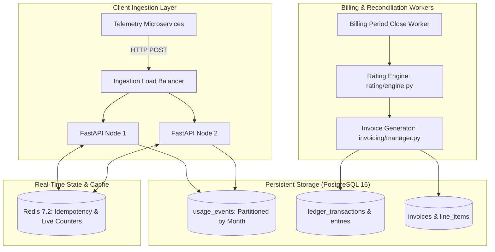
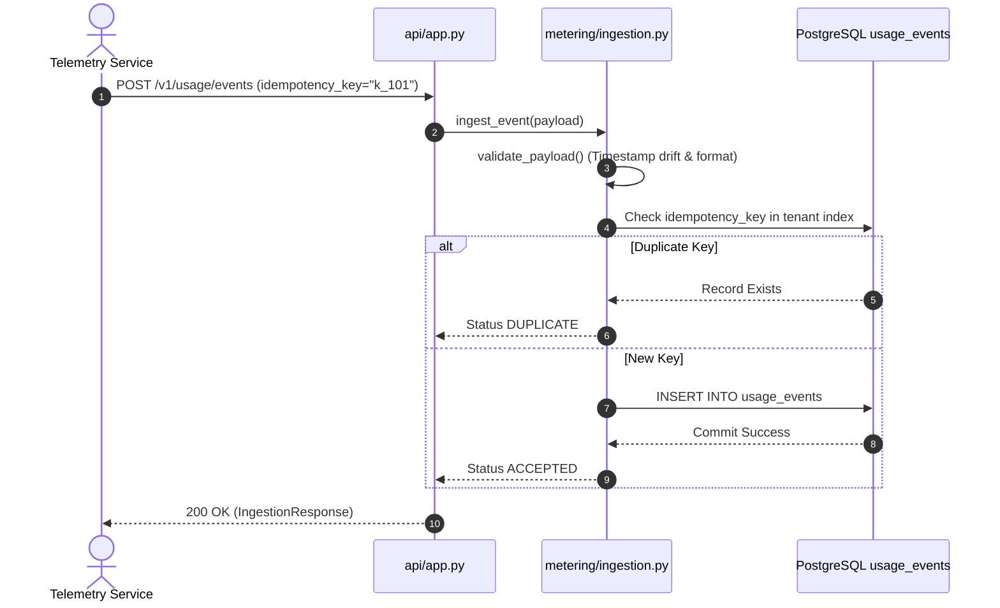
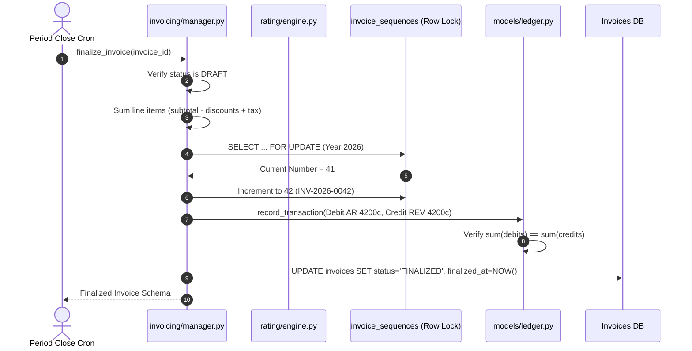
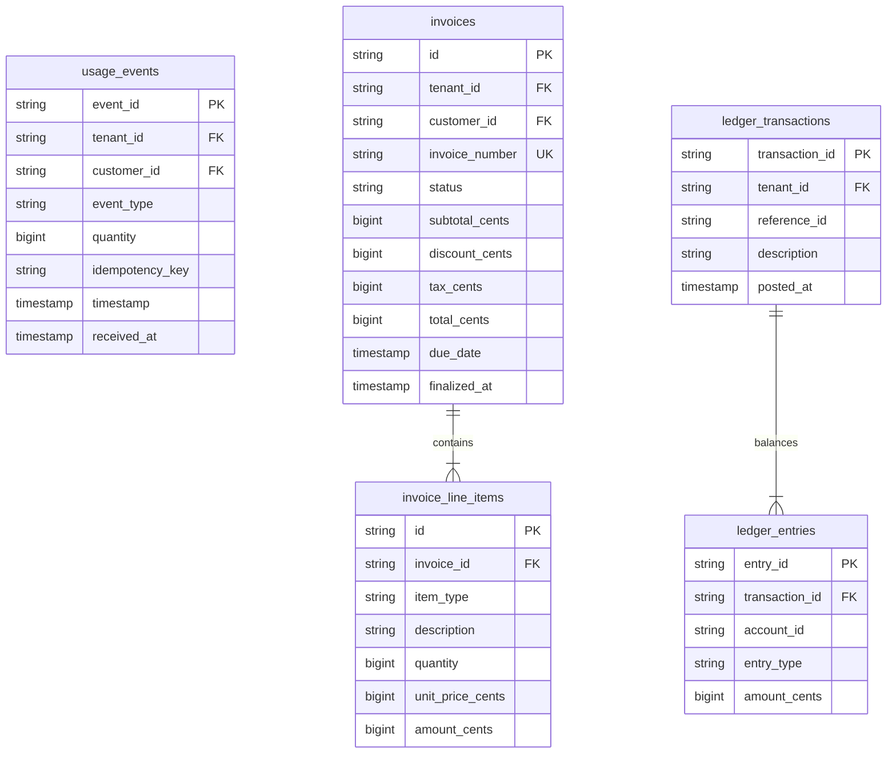

# System Architecture & Scalability

## 1. High-Level Architecture
`19-usage-billing-engine` is architected as an event-driven, modular financial platform. Ingestion paths are decoupled from rating and billing cycles, allowing ingestion to scale horizontally without blocking complex end-of-month financial reconciliation.

---

## 2. Request Lifecycles (Top 3 Features)

### Lifecycle 1: Ingesting a Usage Event

---

### Lifecycle 2: Billing Cycle Close & Finalization

---

## 3. Database Schema & ER Diagram

---

## 4. Scaling to 100x Traffic & First 3 Bottlenecks

### Current Scale vs 100x Scale
- **Current Load**: 500 events/second, 10,000 monthly invoices.
- **100x Load**: 50,000 events/second ($4.3 \text{ billion events/month}$), 1,000,000 monthly invoices.

### Top 3 Bottlenecks & Architectural Remedies

| Bottleneck Rank | Vulnerable Component | Failure Mode at 100x | Senior Engineer Remediation |
| :--- | :--- | :--- | :--- |
| **1** | **Synchronous PostgreSQL Ingestion** | B-tree index contention on `ix_tenant_idem` causes database lock exhaustion. | Introduce Apache Kafka or AWS Kinesis buffer in front of workers, batching DB writes into multi-row 1,000-event inserts. |
| **2** | **Invoice Sequence Row Locking** | `SELECT ... FOR UPDATE` on `invoice_sequences` serializes finalization to ~100 invoices/sec. | Partition sequence counters by tenant shard or allocate pre-fetched block ranges (Hi/Lo sequence algorithm). |
| **3** | **Differential Usage Recompute** | Running SQL `SUM(quantity)` across 50M raw rows during period close causes query timeouts. | Transition to continuous tumbling stream aggregates in Redis / Apache Flink, using PostgreSQL only for cold storage. |
