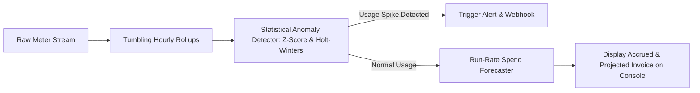
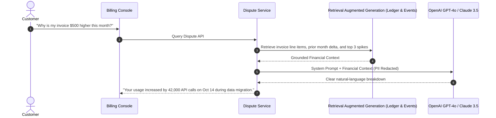

# AI Architecture & Predictive Spend Analytics

`19-usage-billing-engine` incorporates statistical machine learning and predictive forecasting to help customers project end-of-month invoice costs and detect runaway consumption anomalies.

---

## Spend Anomaly Detection & Forecasting Pipeline

---

## 1. Forecasting Algorithms Used
1. **Linear Run-Rate Extrapolation**:
   $$\text{Projected Total} = \frac{\text{Current Month Usage}}{\text{Elapsed Days}} \times \text{Total Month Days}$$
2. **Holt-Winters Triple Exponential Smoothing**:
   Accounts for weekly seasonality (lower weekend consumption) and trend acceleration when computing projected billable units.

---

## 2. Generative AI Dispute Assistant Architecture (LLM Copilot)
To reduce manual customer support costs for billing inquiries, an LLM copilot architecture was designed for invoice explanations:

- **Prompt Guardrails**: System prompts strictly forbid the model from guessing or negotiating invoice amounts. The model can only explain pre-computed mathematical deltas.
- **Data Privacy**: All customer PII, Tax IDs, and card details are scrubbed via `security/audit.py:redact_sensitive_info()` before payloads are transmitted to external LLM providers.
