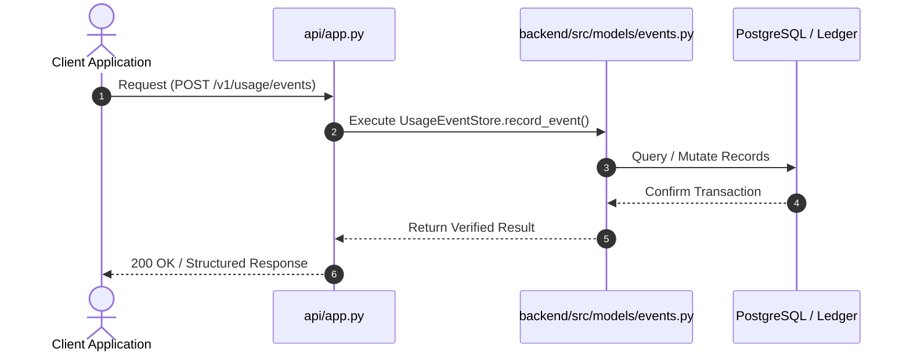
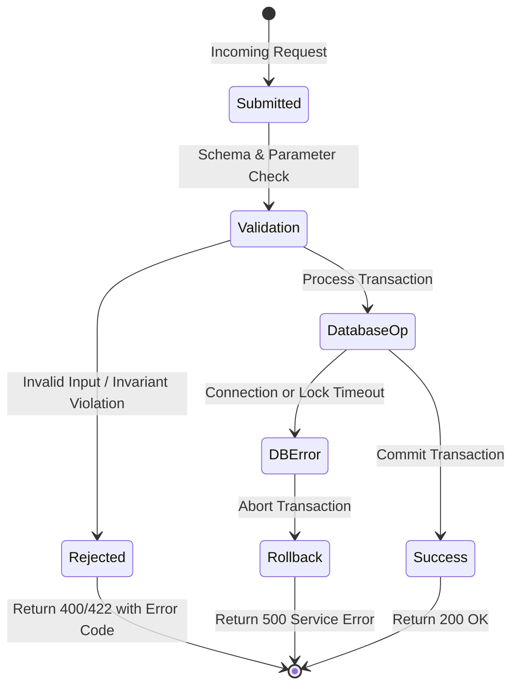

# F1: Usage Event Store & Dimension Storage

## 1. Feature Overview & Architecture
Granular metered usage records with multi-dimensional metadata, tenant isolation, and composite unique idempotency constraints.

- **Primary Source File**: `backend/src/models/events.py:L14-L157`
- **API Endpoints**: `POST /v1/usage/events, GET /v1/usage/events`
- **Storage Layer**: Table: usage_events (event_id, tenant_id, customer_id, event_type, quantity, dimensions_json, idempotency_key, timestamp, received_at). Indexes: ix_tenant_idem (unique), ix_tenant_cust_time, ix_usage_tenant_cust_type_time.

---

## 2. Architectural Flow Diagrams

### System Architecture Flowchart
```mermaid
flowchart TD
    Client[Client / Caller] --> API[FastAPI Route: POST /v1/usage/events]
    API --> Logic[UsageEventStore.record_event]
    Logic --> Storage[(Table: usage_events (event_id, tenant_id, customer_id, event_type, quantity, dimensions_json, idempotency_key, timestamp, received_at))]
    Storage --> Response[Acknowledge Exact Result]
```

### Execution Sequence Diagram


### Failure Path Handling


---

## 3. Function & Implementation Details

| Function | Parameters | Return Type | Description |
| :--- | :--- | :--- | :--- |
| `UsageEventStore.record_event` | `event_id: str, tenant_id: str, customer_id: str, event_type: str, quantity: int, idempotency_key: str, timestamp: datetime, dimensions: dict` | `UsageEventSchema` | Persists an atomic usage event with duplicate checking and dimension serialization |

---

## 4. Edge Cases, Security & Engineering Quality
- **Edge Cases & Error Handling**: Negative quantity rejected via database check constraint `chk_usage_quantity_nonneg`. Replayed idempotency keys return existing record without duplicate insertion.
- **Security Considerations**: Tenant ID indexed on all queries, preventing cross-tenant information leakage. Dimensions stored as serialized JSON string to prevent SQL injection.
- **Performance Optimizations**: Composite indexing allows index-only or index-range scans across tenant, customer, and timestamp dimensions. Time-partitioned in PostgreSQL.
- **Known Limitations & Trade-Offs**: Dimensions are limited to 1024 characters; large unstructured metadata must be offloaded to external blob storage.

---

## 5. Say It Out Loud (Spoken Interview Explanation)
> "I built the usage event store in models/events.py to act as the single source of truth for all customer consumption. When raw telemetry arrives, my store validates that the usage quantity is non-negative and serializes custom metadata like project IDs or compute regions into a JSON column.
To guarantee that network retries never lead to duplicate charges, I created a composite unique index on tenant ID and idempotency key directly in PostgreSQL. If an event with the same key arrives again, my query detects the existing record and returns it immediately instead of inserting a duplicate.
I chose a relational schema with B-tree composite indexes over a NoSQL document database because financial billing demands ACID consistency and strict unique constraints across concurrent requests.
If the database connection drops or a negative quantity is submitted, the transaction rolls back cleanly and returns a structured error to the caller.
One limitation is that our dimension column is capped at 1024 bytes, so for clients needing massive telemetry payloads, I would introduce an external blob reference."
