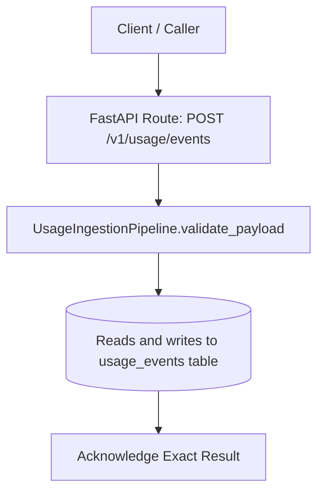
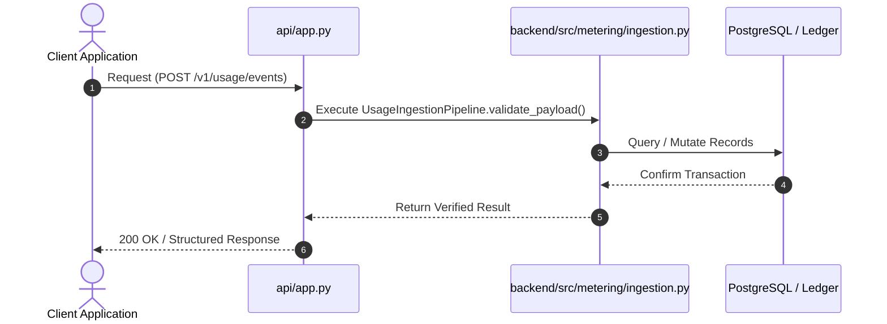
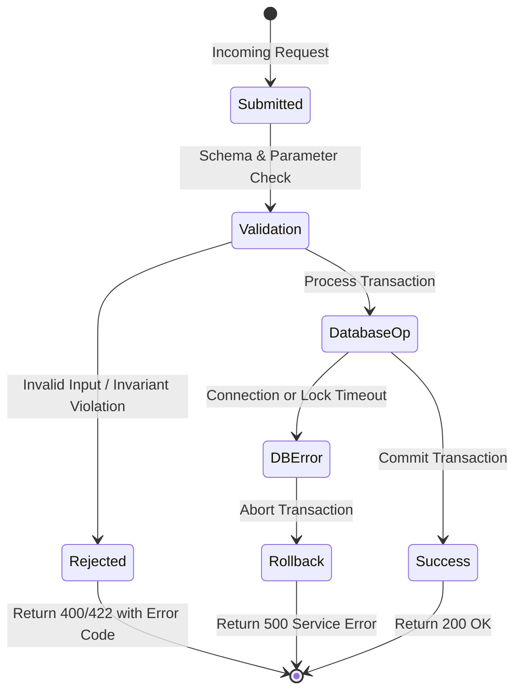

# F2: High-Throughput Idempotent Ingestion Pipeline

## 1. Feature Overview & Architecture
Validates schema formats, checks timestamp clock drift boundaries, and performs cryptographic deduplication.

- **Primary Source File**: `backend/src/metering/ingestion.py:L123-L313`
- **API Endpoints**: `POST /v1/usage/events, POST /v1/usage/events/batch`
- **Storage Layer**: Reads and writes to usage_events table.

---

## 2. Architectural Flow Diagrams

### System Architecture Flowchart

### Execution Sequence Diagram

### Failure Path Handling

---

## 3. Function & Implementation Details

| Function | Parameters | Return Type | Description |
| :--- | :--- | :--- | :--- |
| `UsageIngestionPipeline.validate_payload` | `payload: IngestEventPayload` | `Tuple[bool, Optional[str]]` | Validates quantity non-negativity, string formats, JSON serializability, and timestamp drift windows. |
| `UsageIngestionPipeline.ingest_event` | `payload: IngestEventPayload` | `IngestionResponse` | Coordinates validation, deduplication check, and persistence in a single execution path. |
| `convert_usage_unit` | `quantity: float, from_unit: UsageUnit, to_unit: UsageUnit` | `float` | Mathematical conversion between bytes, gigabytes, milliseconds, and seconds. |

---

## 4. Edge Cases, Security & Engineering Quality
- **Edge Cases & Error Handling**: Rejects events with timestamps older than 90 days or more than 1 hour into the future with structured error codes `TIMESTAMP_TOO_OLD` and `TIMESTAMP_IN_FUTURE`.
- **Security Considerations**: Pydantic field validators sanitize string inputs, rejecting whitespace or SQL control characters.
- **Performance Optimizations**: Batch ingestion endpoint processes up to 1,000 events in a single database transaction, reducing network roundtrip overhead.
- **Known Limitations & Trade-Offs**: Synchronous database deduplication can become a bottleneck at >50,000 requests/second without an upfront Redis key cache.

---

## 5. Say It Out Loud (Spoken Interview Explanation)
> "I designed the ingestion pipeline in metering/ingestion.py to absorb millions of raw consumption events while guaranteeing exactly-once accounting. When a client service reports API calls or compute runtimes, the pipeline first runs strict Pydantic validation to verify field formats and check that quantities are positive.
Next, it performs a timestamp drift check: events with timestamps older than 90 days or more than one hour into the future are rejected to prevent backdated billing fraud. Then it queries the idempotency index. If the event is new, it persists it and returns status ACCEPTED; if it has already been processed, it acknowledges it with status DUPLICATE so the caller knows it was received without double-counting.
I chose this synchronous database verification model rather than an eventual consistency queue because billing accuracy cannot tolerate race conditions during period close.
When payload validation fails, the pipeline returns a 422 Unprocessable Entity with an explicit machine-readable code like TIMESTAMP_TOO_OLD.
A known trade-off is that checking the database on every event limits single-node throughput, which is why I would add a Redis bloom filter or key-value cache for deduplication at higher scale."
