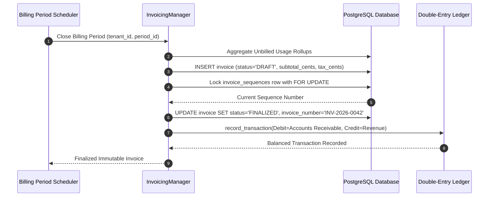

# F3: Automated Invoicing & Gapless Numbering

## Overview & Architecture
The invoicing manager in `backend/src/invoicing/manager.py` coordinates period-end aggregation, immutable invoice generation, line-item tax calculations, and sequential numbering.

## Say It Out Loud
> "I developed the invoicing engine in `invoicing/manager.py` to manage the complete lifecycle from draft usage aggregation to finalized customer bills. When a billing cycle closes, our system generates a draft invoice and appends itemized line items for metered usage, subscription base fees, discounts, and taxes.
> 
> When the invoice is finalized, the manager locks the invoice into an immutable state so no further edits can occur. It calculates total cents using the formula: subtotal minus discounts minus credits plus tax.
> 
> To satisfy strict accounting and legal compliance, it queries an invoice sequences table with row-level locking to assign a gapless sequential number formatted as INV-year-number, guaranteeing no numbers are skipped even under concurrent finalization requests.
> 
> Simultaneously, it triggers a double-entry ledger posting to debit Accounts Receivable and credit Revenue.
> 
> I chose this multi-stage lifecycle (Draft to Finalized to Paid or Void) because enterprise finance teams require the ability to review and adjust draft line items before locking legal fiscal records.
> 
> If someone attempts to modify a finalized invoice, the method raises a 400 Bad Request error.
> 
> A limitation is that invoice PDF rendering currently relies on the browser's print engine, which I plan to supplement with a server-side PDF generator."
