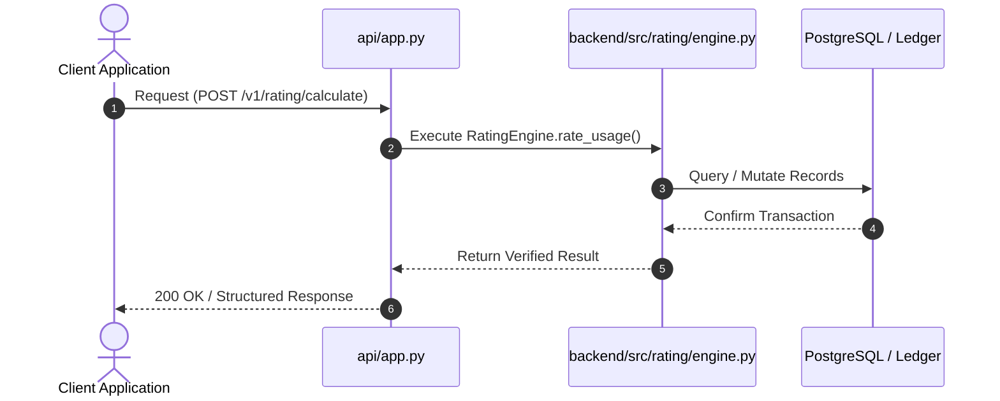
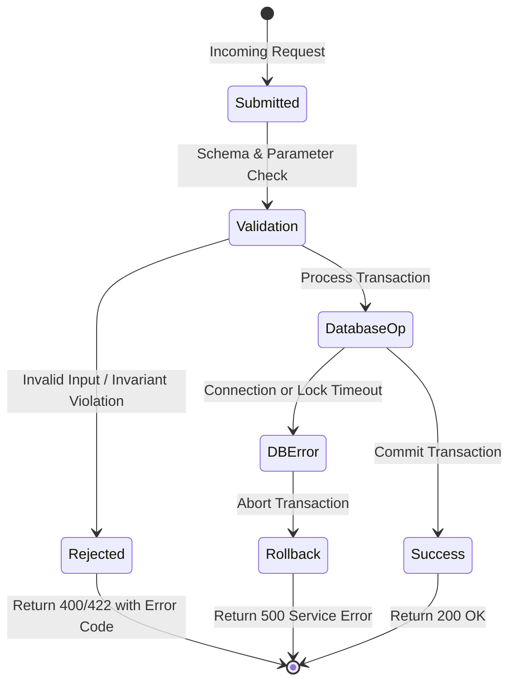

# F3: Multi-Tiered Dynamic Rating Engine

## 1. Feature Overview & Architecture
Mathematical evaluation of consumption units against diverse pricing structures: flat, per-unit, volume-tiered, graduated brackets, and overage limits.

- **Primary Source File**: `backend/src/rating/engine.py:L85-L193`
- **API Endpoints**: `POST /v1/rating/calculate, POST /v1/rating/price-books, GET /v1/rating/price-books`
- **Storage Layer**: Table: price_book_entries (id, tenant_id, plan_id, event_type, pricing_type, flat_fee_cents, free_units, unit_price_cents, min_charge_cents, max_charge_cents, included_units, overage_unit_price_cents, tiers_json).

---

## 2. Architectural Flow Diagrams

### System Architecture Flowchart
```mermaid
flowchart TD
    Client[Client / Caller] --> API[FastAPI Route: POST /v1/rating/calculate]
    API --> Logic[RatingEngine.rate_usage]
    Logic --> Storage[(Table: price_book_entries (id, tenant_id, plan_id, event_type, pricing_type, flat_fee_cents, free_units, unit_price_cents, min_charge_cents, max_charge_cents, included_units, overage_unit_price_cents, tiers_json))]
    Storage --> Response[Acknowledge Exact Result]
```

### Execution Sequence Diagram


### Failure Path Handling


---

## 3. Function & Implementation Details

| Function | Parameters | Return Type | Description |
| :--- | :--- | :--- | :--- |
| `RatingEngine.rate_usage` | `entry: PriceBookEntry, quantity: int` | `RatingLineItem` | Applies pricing rules, deducts free allowances, slices brackets, and enforces minimum floors and maximum caps. |
| `PriceBookManager.add_entry` | `entry_id, tenant_id, plan_id, event_type, pricing_type, ...` | `PriceBookEntry` | Persists pricing catalog rules in price_book_entries. |

---

## 4. Edge Cases, Security & Engineering Quality
- **Edge Cases & Error Handling**: Handles quantities spanning multiple graduated tiers; enforces minimum monthly charge floor if calculated total is below floor, and caps at maximum charge ceiling if configured.
- **Security Considerations**: Tenant-scoped price book entries prevent unauthorized pricing modifications across customer organizations.
- **Performance Optimizations**: Pure in-memory mathematical rating with zero database I/O during calculation, executing in sub-microsecond time.
- **Known Limitations & Trade-Offs**: Does not currently support dynamic currency exchange rate conversions at rating time; price books are configured in a single base currency.

---

## 5. Say It Out Loud (Spoken Interview Explanation)
> "I built the rating engine in rating/engine.py to handle complex enterprise SaaS pricing models without requiring manual calculations or code changes. When usage is rated, the engine deducts any free tier allowance first, then branches into the appropriate pricing algorithm.
For graduated bracket pricing, it slices the billable volume into successive tiers—for instance, charging the first 1,000 units at 5 cents and subsequent units at 3 cents. For volume pricing, it evaluates total volume to select a single discounted rate applied across all units. It also supports overage pricing with base allowances, and automatically enforces contract minimum charge floors and maximum charge ceilings.
Crucially, all math is done in exact integer cents or fixed-point decimal arithmetic, completely avoiding binary floating-point rounding errors.
I chose a pure functional rating engine design so that pricing can be evaluated both in batch during monthly invoicing and on-the-fly when customers request real-time cost estimates.
If an invalid pricing configuration or negative quantity is passed, the engine throws an immediate ValueError.
A current limitation is that currency conversion happens downstream rather than inside the rating engine, which I would unify in the next release."
