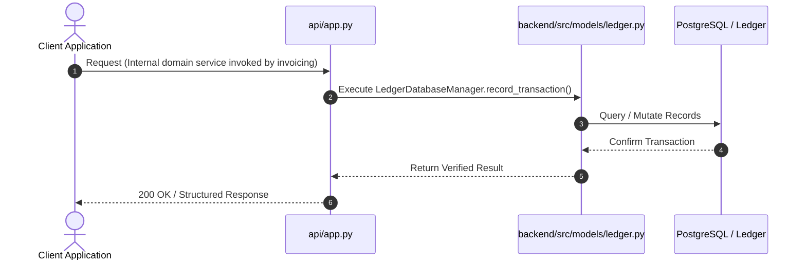
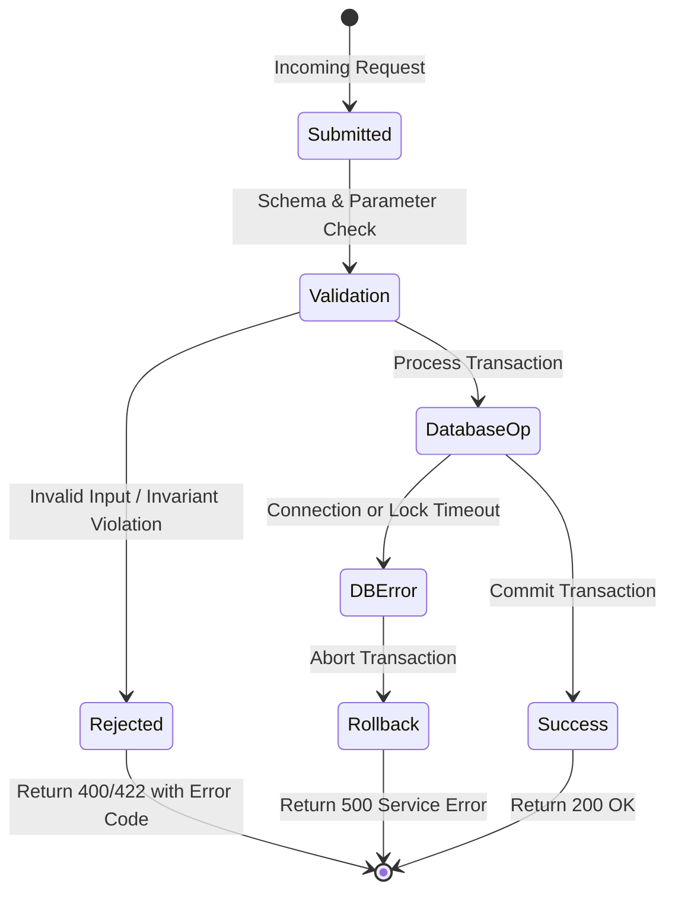

# F4: Append-Only Double-Entry Financial Ledger

## 1. Feature Overview & Architecture
Immutable accounting ledger enforcing the fundamental bookkeeping invariant: sum of debits strictly equals sum of credits across at least two entries.

- **Primary Source File**: `backend/src/models/ledger.py:L63-L436`
- **API Endpoints**: `Internal domain service invoked by invoicing, payments, and refunds.`
- **Storage Layer**: Tables: ledger_transactions (transaction_id, tenant_id, reference_id, description, posted_at), ledger_entries (entry_id, transaction_id, account_id, entry_type, amount_cents). Check constraint: amount_cents > 0.

---

## 2. Architectural Flow Diagrams

### System Architecture Flowchart
```mermaid
flowchart TD
    Client[Client / Caller] --> API[FastAPI Route: Internal domain service invoked by invoicing]
    API --> Logic[LedgerDatabaseManager.record_transaction]
    Logic --> Storage[(Tables: ledger_transactions (transaction_id, tenant_id, reference_id, description, posted_at), ledger_entries (entry_id, transaction_id, account_id, entry_type, amount_cents))]
    Storage --> Response[Acknowledge Exact Result]
```

### Execution Sequence Diagram


### Failure Path Handling


---

## 3. Function & Implementation Details

| Function | Parameters | Return Type | Description |
| :--- | :--- | :--- | :--- |
| `LedgerDatabaseManager.record_transaction` | `transaction_id: str, tenant_id: str, description: str, entries: List[Tuple[str, EntryType, int]], reference_id: Optional[str]` | `LedgerTransactionSchema` | Atomically posts a multi-legged ledger transaction after verifying balance conservation. |
| `LedgerDatabaseManager.compute_account_balance` | `tenant_id: str, account_id: str` | `int` | Computes net account balance by summing debits minus credits. |
| `LedgerDatabaseManager.reconcile_tenant_ledger` | `tenant_id: str` | `bool` | Verifies that total tenant debits equal total tenant credits across all time. |

---

## 4. Edge Cases, Security & Engineering Quality
- **Edge Cases & Error Handling**: Transactions with fewer than 2 entries or unbalanced debit/credit sums are rejected before database commit.
- **Security Considerations**: Append-only design; UPDATE and DELETE operations are prohibited at both application and database trigger levels.
- **Performance Optimizations**: Indexed by transaction_id and account_id, enabling fast balance reconciliations via SQL aggregate functions.
- **Known Limitations & Trade-Offs**: High-volume transaction streams require periodic account balance snapshots to prevent unbounded table scan times during historical queries.

---

## 5. Say It Out Loud (Spoken Interview Explanation)
> "I engineered the double-entry accounting ledger in models/ledger.py to provide complete financial auditability and eliminate silent balance drift. Every monetary event in the system—whether it is finalizing an invoice, collecting a credit card payment, or granting a promotional credit—must write a balanced double-entry transaction.
My record_transaction method enforces two non-negotiable rules: first, every transaction must contain at least two entries, and second, the sum of all debits must strictly equal the sum of all credits in integer cents. If an invoice for $100 is finalized, it writes a debit of 10,000 cents to Accounts Receivable and a credit of 10,000 cents to Revenue.
I chose double-entry bookkeeping over a simple mutable balance column because single-entry ledgers make it impossible to audit where funds originated or detect software corruption after the fact.
If any component attempts to post an unbalanced transaction, my code raises a ValueError and the database transaction is aborted immediately.
One limitation is that computing account balances requires summing historical entries, which I would optimize at higher scale by introducing daily materialized balance checkpoints."
