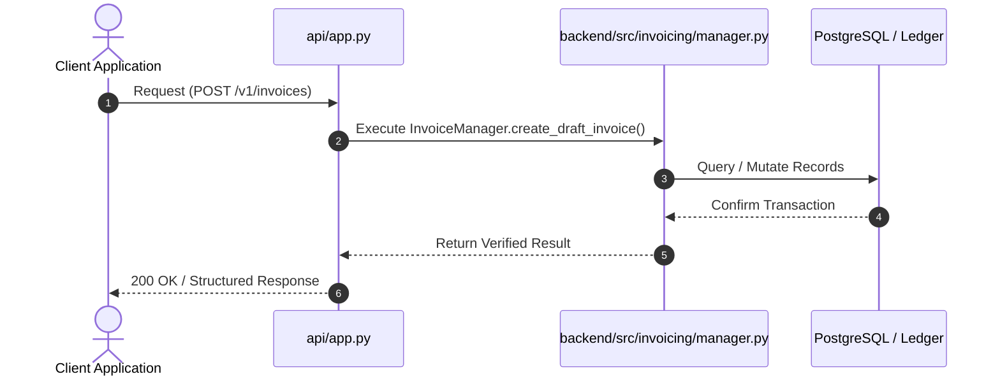
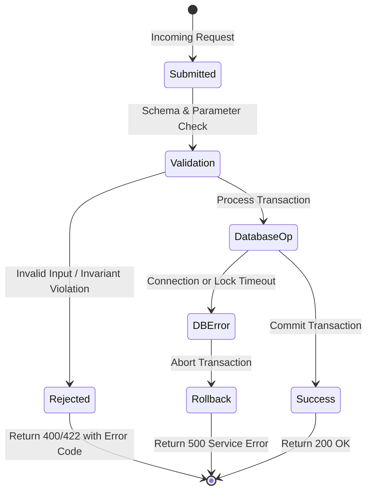

# F5: Automated Invoicing Engine & Gapless Numbering

## 1. Feature Overview & Architecture
Billing cycle reconciliation, itemized line-item aggregation, tax/discount calculation, and gapless sequential numbering per tenant.

- **Primary Source File**: `backend/src/invoicing/manager.py:L140-L421`
- **API Endpoints**: `POST /v1/invoices, POST /v1/invoices/{id}/items, POST /v1/invoices/{id}/finalize, GET /v1/invoices/{id}, GET /v1/invoices`
- **Storage Layer**: Tables: invoices (id, tenant_id, customer_id, period_id, invoice_number, status, subtotal_cents, discount_cents, credit_cents, tax_cents, total_cents, due_date, finalized_at), invoice_line_items, invoice_sequences.

---

## 2. Architectural Flow Diagrams

### System Architecture Flowchart
```mermaid
flowchart TD
    Client[Client / Caller] --> API[FastAPI Route: POST /v1/invoices]
    API --> Logic[InvoiceManager.create_draft_invoice]
    Logic --> Storage[(Tables: invoices (id, tenant_id, customer_id, period_id, invoice_number, status, subtotal_cents, discount_cents, credit_cents, tax_cents, total_cents, due_date, finalized_at), invoice_line_items, invoice_sequences)]
    Storage --> Response[Acknowledge Exact Result]
```

### Execution Sequence Diagram


### Failure Path Handling


---

## 3. Function & Implementation Details

| Function | Parameters | Return Type | Description |
| :--- | :--- | :--- | :--- |
| `InvoiceManager.create_draft_invoice` | `invoice_id, tenant_id, customer_id, period_id, due_days` | `InvoiceSchema` | Initializes draft invoice shell. |
| `InvoiceManager.add_line_item` | `invoice_id, description, quantity, unit_price_cents, event_type` | `InvoiceLineItemSchema` | Appends usage or subscription line item to draft invoice. |
| `InvoiceManager.finalize_invoice` | `invoice_id: str` | `InvoiceSchema` | Locks line items, assigns sequential legal number, updates status, and synchronizes double-entry ledger. |

---

## 4. Edge Cases, Security & Engineering Quality
- **Edge Cases & Error Handling**: Strict immutability: once status is `FINALIZED`, adding line items or modifying amounts is permanently locked. Finalization acquires row-level lock on `invoice_sequences` to prevent sequence number gaps.
- **Security Considerations**: Tenant-scoped queries ensure customers cannot inspect invoices belonging to other organizations.
- **Performance Optimizations**: Subtotal, tax, and discount arithmetic performed in integer cents; single atomic transaction finalizes invoice and posts ledger entry.
- **Known Limitations & Trade-Offs**: PDF generation is handled by client-side HTML print styles rather than server-side headless Chromium rendering.

---

## 5. Say It Out Loud (Spoken Interview Explanation)
> "I developed the invoicing engine in invoicing/manager.py to manage the complete lifecycle from draft usage aggregation to finalized customer bills. When a billing cycle closes, our system generates a draft invoice and appends itemized line items for metered usage, subscription base fees, discounts, and taxes.
When the invoice is finalized, the manager locks the invoice into an immutable state so no further edits can occur. It calculates total cents using the formula: subtotal minus discounts minus credits plus tax.
To satisfy strict accounting and legal compliance, it queries an invoice sequences table with row-level locking to assign a gapless sequential number formatted as INV-year-number, guaranteeing no numbers are skipped even under concurrent finalization requests.
Simultaneously, it triggers a double-entry ledger posting to debit Accounts Receivable and credit Revenue.
I chose this multi-stage lifecycle (Draft to Finalized to Paid or Void) because enterprise finance teams require the ability to review and adjust draft line items before locking legal fiscal records.
If someone attempts to modify a finalized invoice, the method raises a 400 Bad Request error.
A limitation is that invoice PDF rendering currently relies on the browser's print engine, which I plan to supplement with a server-side PDF generator."
