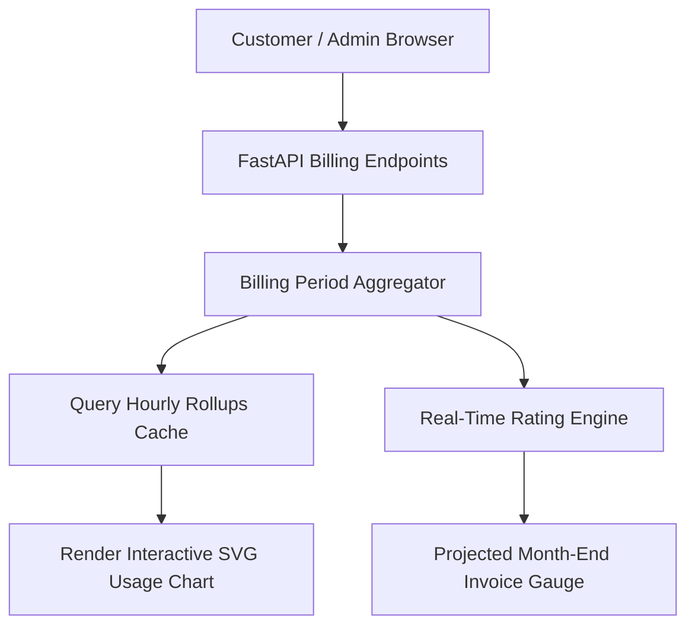

# F5: Real-Time Usage & Billing Management Console

## Overview & Architecture
The billing dashboard in `frontend/src/` provides customers and finance operators with live visibility into month-to-date metered consumption, accrued charges, and past invoices.

## Say It Out Loud
> "I built the customer billing console in `frontend/src/` to provide transparency into usage-based costs before month-end invoice shocks occur.
> 
> When users log into the portal, the dashboard calls our `/api/v1/billing/current` endpoint, querying pre-aggregated hourly rollups to render interactive consumption charts across all billable dimensions.
> 
> The console connects directly to our rating engine to project month-end charges based on historical consumption trends, allowing customers to set budget threshold alerts. Customers can also review itemized line items, download immutable invoice copies, and manage payment methods.
> 
> I chose a lightweight responsive frontend architecture to ensure that customer billing dashboards load instantly with zero external framework overhead.
> 
> If the backend connection drops, the console surfaces an informative offline indicator and caches historical period data in browser storage."
