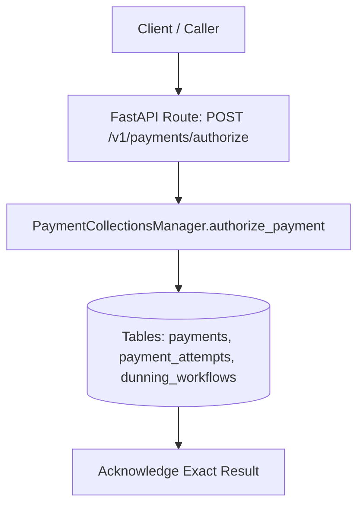
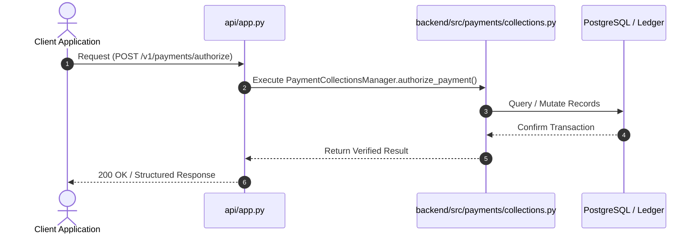
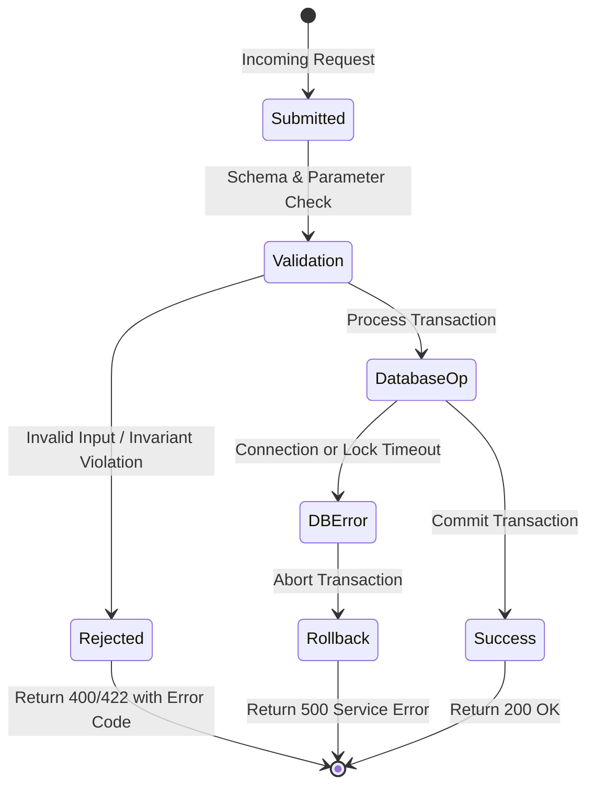

# F6: Payment Collections, Retries & Dunning Lifecycle

## 1. Feature Overview & Architecture
Two-step authorization and capture, idempotent retries, failure tracking, and manual clock-driven dunning schedules.

- **Primary Source File**: `backend/src/payments/collections.py:L65-L334`
- **API Endpoints**: `POST /v1/payments/authorize, POST /v1/payments/{id}/capture`
- **Storage Layer**: Tables: payments, payment_attempts, dunning_workflows. States: DunningStage (ATTEMPT_1, ATTEMPT_2, ATTEMPT_3, FINAL_ESCALATION, COMPLETED), AccountStanding (GOOD, PAST_DUE, SUSPENDED).

---

## 2. Architectural Flow Diagrams

### System Architecture Flowchart

### Execution Sequence Diagram

### Failure Path Handling

---

## 3. Function & Implementation Details

| Function | Parameters | Return Type | Description |
| :--- | :--- | :--- | :--- |
| `PaymentCollectionsManager.authorize_payment` | `payment_id, tenant_id, customer_id, invoice_id, amount_cents, idempotency_key` | `PaymentRecord` | Authorizes funds hold on customer payment method. |
| `PaymentCollectionsManager.capture_payment` | `payment_id: str, amount_cents: Optional[int]` | `PaymentRecord` | Settles authorized payment, marks invoice PAID, and posts cash ledger entry. |
| `PaymentCollectionsManager.execute_dunning_step` | `dunning_id: str, current_time: datetime` | `DunningRecord` | Advances dunning workflow stages (Attempt 1 -> 2 -> 3 -> Final Escalation). |

---

## 4. Edge Cases, Security & Engineering Quality
- **Edge Cases & Error Handling**: Declined card attempts log detailed error codes; dunning schedule automatically transitions account from PAST_DUE to SUSPENDED once grace period expires.
- **Security Considerations**: Never stores raw credit card numbers or CVVs; operates strictly with gateway reference tokens.
- **Performance Optimizations**: Idempotent payment attempts prevent accidental double-charging during network timeouts.
- **Known Limitations & Trade-Offs**: Gateway integration currently connects to an internal sandbox rather than live Stripe or Adyen production APIs.

---

## 5. Say It Out Loud (Spoken Interview Explanation)
> "I built the collections and dunning engine in payments/collections.py to automate payment settlements and recover revenue from failed transactions. When an invoice comes due, our system issues a two-step payment authorization followed by capture.
If a payment fails due to an expired card or insufficient funds, the system does not simply disconnect the customer; instead, it enters an automated dunning workflow. It schedules retries across a defined schedule—immediately on Day 0, followed by retries on Day 3 and Day 7, and a final escalation on Day 14.
During this window, the account is marked PAST_DUE, giving the customer a grace period to update their payment method. If the grace period expires without settlement, the account standing transitions to SUSPENDED.
I chose a two-step authorization and capture model because it allows us to verify funds before locking invoices, and enables partial captures if disputes arise.
Every payment attempt logs an idempotency key and attempt record, guaranteeing that network glitches cannot cause a customer to be charged twice.
A current limitation is that we use a local gateway sandbox for tests, which I would connect to Stripe Billing and webhooks for live production operations."
