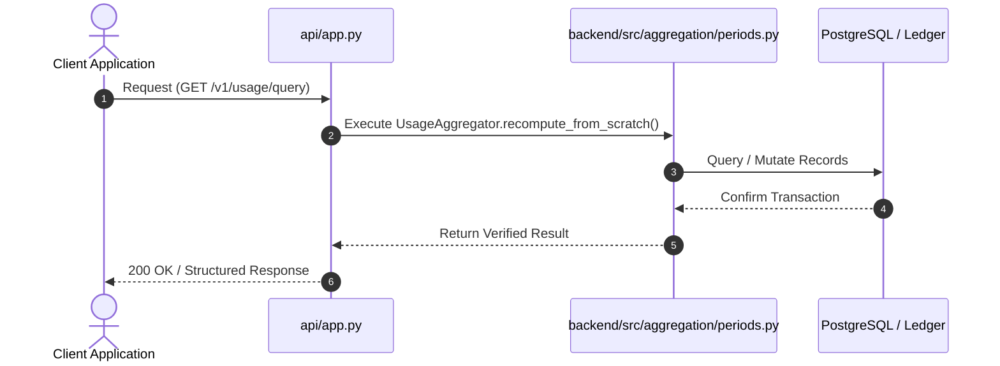
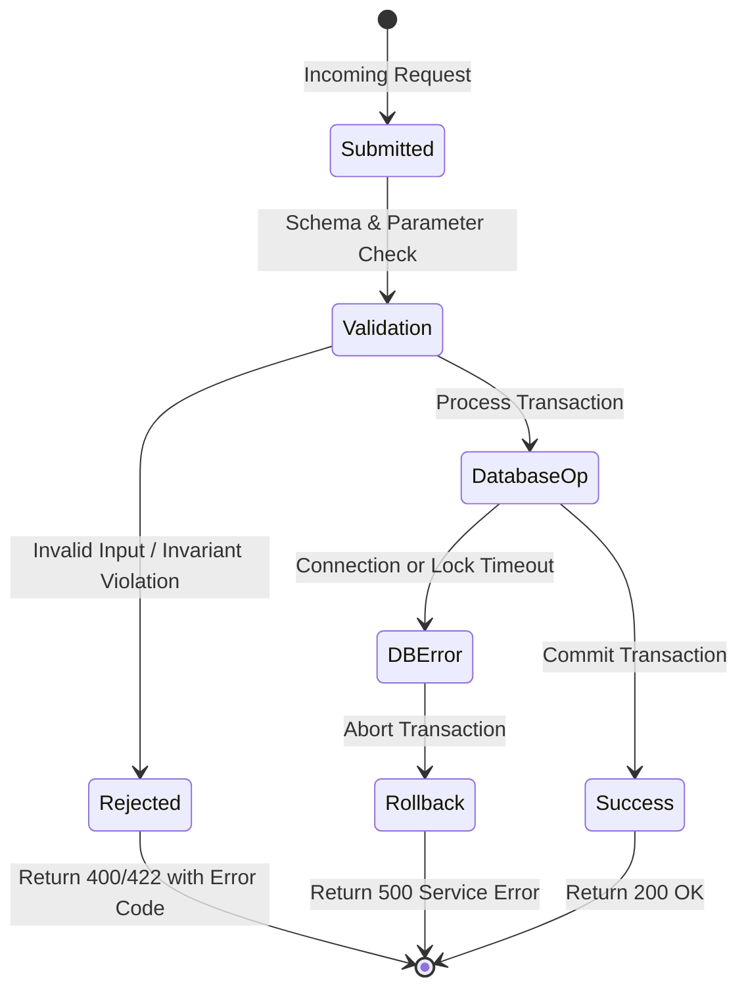

# F7: Aggregation Engine & Billing Period Lifecycle

## 1. Feature Overview & Architecture
Monthly and hourly usage aggregation, period state transitions (OPEN -> CLOSING -> CLOSED), and differential recompute verification.

- **Primary Source File**: `backend/src/aggregation/periods.py:L130-L414`
- **API Endpoints**: `GET /v1/usage/query`
- **Storage Layer**: Tables: billing_periods (period_id, tenant_id, customer_id, start_date, end_date, status, closed_at), usage_rollups (id, tenant_id, customer_id, event_type, granularity, bucket_start, bucket_end, total_quantity, event_count).

---

## 2. Architectural Flow Diagrams

### System Architecture Flowchart
```mermaid
flowchart TD
    Client[Client / Caller] --> API[FastAPI Route: GET /v1/usage/query]
    API --> Logic[UsageAggregator.recompute_from_scratch]
    Logic --> Storage[(Tables: billing_periods (period_id, tenant_id, customer_id, start_date, end_date, status, closed_at), usage_rollups (id, tenant_id, customer_id, event_type, granularity, bucket_start, bucket_end, total_quantity, event_count))]
    Storage --> Response[Acknowledge Exact Result]
```

### Execution Sequence Diagram


### Failure Path Handling


---

## 3. Function & Implementation Details

| Function | Parameters | Return Type | Description |
| :--- | :--- | :--- | :--- |
| `UsageAggregator.recompute_from_scratch` | `tenant_id, customer_id, event_type, start_date, end_date` | `int` | Calculates ground-truth usage by querying raw usage_events table. |
| `BillingPeriodManager.open_period` | `period_id, tenant_id, customer_id, start_date, end_date` | `BillingPeriodSchema` | Initializes active billing window. |
| `BillingPeriodManager.close_period` | `period_id: str` | `BillingPeriodSchema` | Closes billing window, locking period against further modifications. |

---

## 4. Edge Cases, Security & Engineering Quality
- **Edge Cases & Error Handling**: Late-arriving events for an already CLOSED period are automatically routed to the current open billing period as prior-period adjustments.
- **Security Considerations**: Tenant and customer query filters prevent cross-tenant usage aggregation.
- **Performance Optimizations**: Hourly and daily rollups pre-aggregate high-volume streams, allowing instant dashboard queries without full table scans.
- **Known Limitations & Trade-Offs**: Hourly rollups require background cron or trigger execution to remain fresh.

---

## 5. Say It Out Loud (Spoken Interview Explanation)
> "I designed the aggregation and periods engine in aggregation/periods.py to manage the lifecycle of billing cycles and aggregate high-volume telemetry. A customer's consumption is divided into distinct billing periods that transition from OPEN to CLOSING and finally CLOSED.
While a period is open, incoming events increment pre-aggregated hourly rollups so dashboard queries return in milliseconds. However, during end-of-month closing, our engine runs a differential test: it executes recompute_from_scratch, which performs a direct SQL sum over raw usage events to prove that pre-aggregated rollups match raw telemetry exactly.
If out-of-order events arrive after a billing period has already closed, the system does not modify historical invoices; instead, it rolls them into the active period as a prior-period adjustment.
I chose to maintain both pre-aggregated rollups and immutable raw events because fast UI queries require caching, but financial audits demand a verifiable raw paper trail.
If dates are inverted or overlapping periods are submitted, the manager raises a clean validation error.
A trade-off is that storing both raw events and rollups increases database storage footprint, which is managed via table partitioning."
