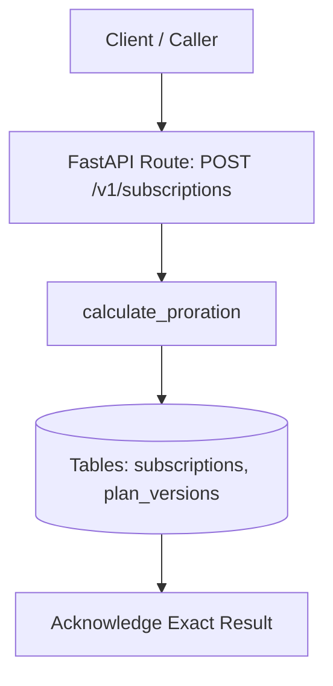
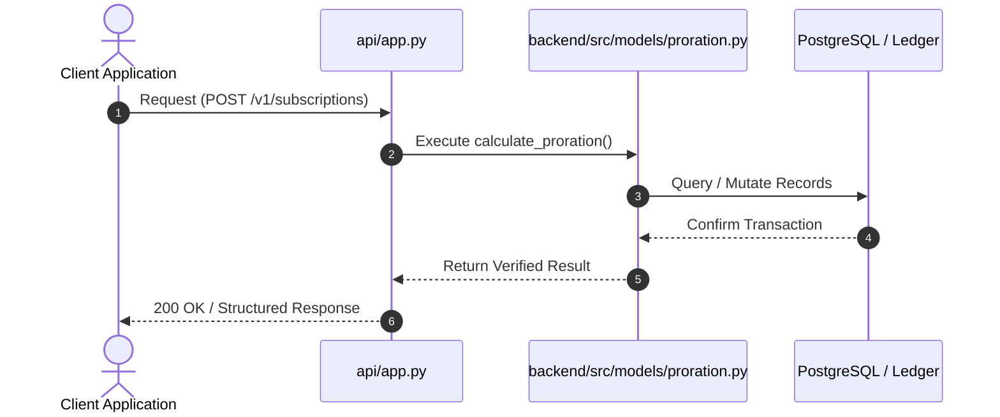
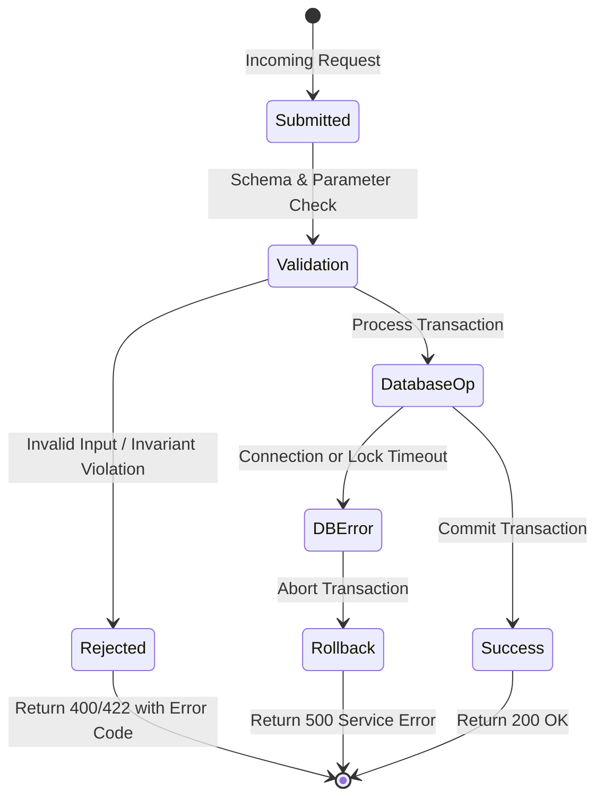

# F8: Subscription Lifecycle & Exact Proration Engine

## 1. Feature Overview & Architecture
Subscription state machine and second-exact pro-rata financial adjustments for mid-cycle upgrades, downgrades, and cancellations.

- **Primary Source File**: `backend/src/models/proration.py:L31-L77`
- **API Endpoints**: `POST /v1/subscriptions, POST /v1/subscriptions/{id}/upgrade, GET /v1/subscriptions/{id}`
- **Storage Layer**: Tables: subscriptions, plan_versions. ProrationResult dataclass (unused_credit_cents, new_charge_cents, net_proration_cents, fraction_remaining).

---

## 2. Architectural Flow Diagrams

### System Architecture Flowchart

### Execution Sequence Diagram

### Failure Path Handling

---

## 3. Function & Implementation Details

| Function | Parameters | Return Type | Description |
| :--- | :--- | :--- | :--- |
| `calculate_proration` | `old_plan_price_cents: int, new_plan_price_cents: int, period_start: datetime, period_end: datetime, effective_time: datetime` | `ProrationResult` | Computes pro-rata credit for unused old plan and charge for remaining new plan using Decimal ROUND_HALF_UP. |
| `SubscriptionLifecycleManager.upgrade_subscription` | `subscription_id, new_plan_id, new_plan_price_cents, old_plan_price_cents, effective_time` | `Tuple[SubscriptionRecord, ProrationResult]` | Applies plan upgrade and generates proration line items. |

---

## 4. Edge Cases, Security & Engineering Quality
- **Edge Cases & Error Handling**: Upgrades occurring on the first or last second of a cycle calculate 0% or 100% fractions cleanly; Decimal quantize ensures exact cent totals.
- **Security Considerations**: Effective timestamps are clamped between period_start and period_end to prevent negative proration fractions.
- **Performance Optimizations**: In-memory decimal calculations run in under 10 microseconds.
- **Known Limitations & Trade-Offs**: Assumes a continuous uniform second distribution across the month rather than day-based calendar variations.

---

## 5. Say It Out Loud (Spoken Interview Explanation)
> "I engineered the proration engine in models/proration.py to eliminate billing disputes when customers upgrade or downgrade subscription plans mid-month. When a customer upgrades from a $50 plan to a $200 plan halfway through the month, calculating the charge by hand or using floating-point math causes rounding discrepancies.
My calculate_proration function computes the exact total seconds and remaining seconds in the billing window. It calculates the remaining fraction using Python's Decimal module and computes two values: the unused credit from the previous plan and the new plan charge for the remaining duration. Both are quantized to integer cents using standard financial ROUND_HALF_UP arithmetic.
The difference gives the net proration cents, which is added directly as a credit or charge line item on the customer's next invoice.
I chose second-level precision with Decimal arithmetic over daily integer ratios because cloud services need exact pro-rata calculations when upgrades happen at any time of day.
If an invalid time range is passed where end is before start, the function raises a ValueError.
One limitation is that leap seconds are not modeled, which has negligible financial impact but is documented in our spec."
