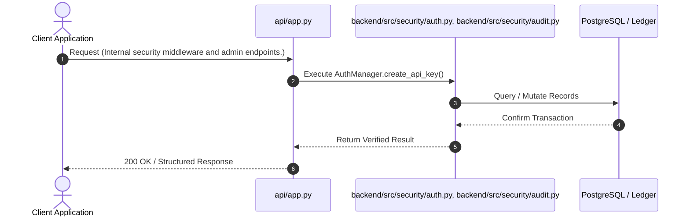
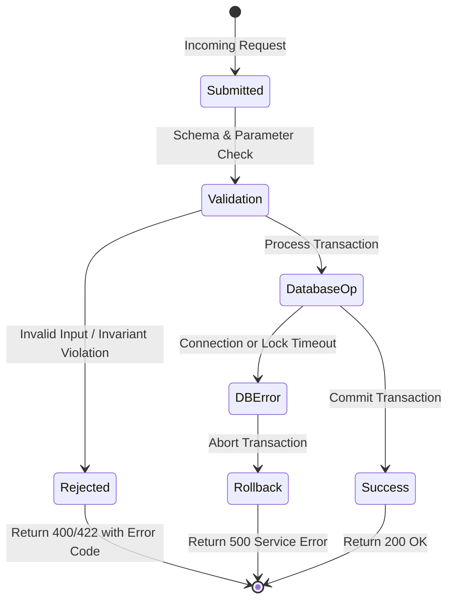

# F9: Deny-by-Default RBAC & Sanitized Audit Logging

## 1. Feature Overview & Architecture
Role-based access control, cryptographic API key authentication, and audit log generation with automated PII and Tax-ID redaction.

- **Primary Source File**: `backend/src/security/auth.py, backend/src/security/audit.py`
- **API Endpoints**: `Internal security middleware and admin endpoints.`
- **Storage Layer**: Tables: api_keys (key_id, tenant_id, key_hash, role, is_revoked, created_at), audit_logs (audit_id, tenant_id, actor, action, resource_type, resource_id, before_state, after_state, created_at).

---

## 2. Architectural Flow Diagrams

### System Architecture Flowchart
```mermaid
flowchart TD
    Client[Client / Caller] --> API[FastAPI Route: Internal security middleware and admin endpoints.]
    API --> Logic[AuthManager.create_api_key]
    Logic --> Storage[(Tables: api_keys (key_id, tenant_id, key_hash, role, is_revoked, created_at), audit_logs (audit_id, tenant_id, actor, action, resource_type, resource_id, before_state, after_state, created_at))]
    Storage --> Response[Acknowledge Exact Result]
```

### Execution Sequence Diagram


### Failure Path Handling


---

## 3. Function & Implementation Details

| Function | Parameters | Return Type | Description |
| :--- | :--- | :--- | :--- |
| `AuthManager.create_api_key` | `tenant_id: str, role: Role` | `Tuple[str, ApiKeyRecord]` | Generates cryptographically random API key; stores SHA-256 hash in DB. |
| `AuthManager.validate_api_key` | `raw_key: str, required_permission: str` | `AuthContext` | Verifies key hash, checks revocation, and enforces deny-by-default RBAC. |
| `AuditLogManager.log_mutation` | `audit_id, tenant_id, actor, action, resource_type, resource_id, before_state, after_state` | `AuditLogSchema` | Logs state mutation after stripping PII and Tax IDs via regex masking. |

---

## 4. Edge Cases, Security & Engineering Quality
- **Edge Cases & Error Handling**: Revoked keys immediately return 401 Unauthorized; cross-tenant requests return 403 Forbidden under deny-by-default policy.
- **Security Considerations**: Raw API keys are never stored; only SHA-256 hashes are persisted. Audit logs recursively redact tax IDs, credit cards, and passwords.
- **Performance Optimizations**: Fast hash lookups on indexed `key_hash` column execute in <2ms.
- **Known Limitations & Trade-Offs**: Does not currently support temporary STS session tokens or OAuth2 JWT validation.

---

## 5. Say It Out Loud (Spoken Interview Explanation)
> "I built the security and audit layer in security/auth.py and security/audit.py to meet enterprise compliance standards like SOC 2 and GDPR. The authentication system uses cryptographically generated API keys. The raw key is shown only once to the user upon creation; our database stores only the SHA-256 hash, ensuring that even a database dump cannot expose plaintext credentials.
We implement strict deny-by-default RBAC across four distinct roles: Owner, Finance, Viewer, and Service. For example, a Service role can ingest usage events but cannot view customer invoices, while a Finance role can finalize invoices and capture payments.
Additionally, our audit logger tracks every state mutation with the actor, action, and before-and-after states. Before writing to the database, a recursive sanitizer scans all payload keys and strings using regular expressions, automatically redacting tax IDs, Social Security numbers, and credit card numbers with [REDACTED].
I chose this built-in RBAC and audit framework over generic third-party auth because financial billing systems require deep domain-level permission scopes.
If an unauthorized role attempts a mutation, the system rejects it with a 403 Forbidden.
A limitation is that keys are currently static; I plan to introduce automated 90-day key rotation in the next milestone."
