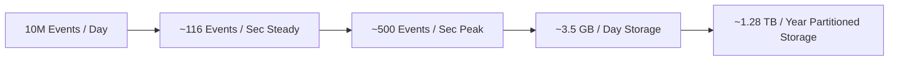

# 14.1 Requirements & Capacity Estimation

## 1. What It Is in Plain Words
Requirements analysis defines the exact operational contract of the software: what features it must deliver (functional) and what performance, availability, and durability guarantees it must maintain (non-functional). Capacity estimation applies back-of-the-envelope arithmetic to calculate bandwidth, CPU, memory, and disk storage growth over time.

---

## 2. How This Project Uses It
In `SPEC.txt` and `backend/src/metering/ingestion.py`:
- **Functional Requirements**:
  1. Ingest raw consumption events (API calls, storage, compute seconds) with client-supplied idempotency keys.
  2. Rate usage against tiered, volume, graduated, and flat-rate price books.
  3. Close billing periods, aggregate rollups, and generate immutable invoices with gapless legal numbering (`INV-YYYY-XXXX`).
  4. Enforce double-entry accounting where $\sum \text{Debits} == \sum \text{Credits}$.
- **Non-Functional Requirements**:
  1. High availability: 99.95% uptime for ingestion endpoints.
  2. Latency: p95 ingestion latency $<25\text{ms}$; rating calculation $<5\text{ms}$.
  3. Strict consistency: Zero duplicate events and zero floating-point rounding drift.

---

## 3. Mathematical Capacity Estimation

### Ingestion Throughput
- **Daily Event Volume**: 10,000,000 events/day across 1,000 active tenants.
- **Average QPS**:
  $$\text{QPS}_{\text{avg}} = \frac{10,000,000 \text{ events}}{86,400 \text{ seconds}} \approx 116 \text{ events/second}$$
- **Peak Load (5x Multiplier)**:
  $$\text{QPS}_{\text{peak}} = 116 \times 5 = 580 \text{ events/second}$$

### Storage Calculations
- **Raw Event Payload Size**:
  - `event_id`: 64 bytes
  - `tenant_id`: 64 bytes
  - `customer_id`: 64 bytes
  - `event_type`: 32 bytes
  - `quantity`: 8 bytes (`BIGINT`)
  - `idempotency_key`: 64 bytes
  - `timestamp`: 8 bytes (`TIMESTAMP`)
  - `dimensions_json`: ~100 bytes
  - Indexes & Overhead: ~150 bytes
  - **Total per Event**: $\approx 350 \text{ bytes}$
- **Daily Storage Influx**:
  $$\text{Daily Storage} = 10,000,000 \times 350 \text{ bytes} \approx 3.5 \text{ GB/day}$$
- **Annual Storage Footprint**:
  $$\text{Annual Storage} = 3.5 \text{ GB} \times 365 \approx 1.28 \text{ TB/year}$$

---

## 4. What Breaks First at 10x, 100x, and 1000x Load
- **At 10x Load (1,160 QPS)**: PostgreSQL B-tree index maintenance slows down; database connection pool hits limits. Remediated by increasing pool size and tuning write-ahead log (WAL) buffers.
- **At 100x Load (11,600 QPS)**: Synchronous database inserts saturate disk write IOPS. Remediated by introducing an Apache Kafka streaming buffer.
- **At 1000x Load (116,000 QPS)**: Single PostgreSQL instance cannot write 350 GB/day. Remediated by horizontally sharding usage event tables by `tenant_id` hash across distinct database nodes.

---

## 5. 30-Second Interview Answer
> "I modeled our billing engine around a daily ingestion volume of 10 million events, translating to an average of 116 requests per second and peak bursts of 580 QPS. At 350 bytes per indexed record, the usage ledger accumulates approximately 3.5 GB of data per day, or 1.28 TB per year. To prevent performance degradation over time, I implemented monthly range partitioning in PostgreSQL, allowing the database engine to isolate active writes to the current month's partition while archiving historical data."

