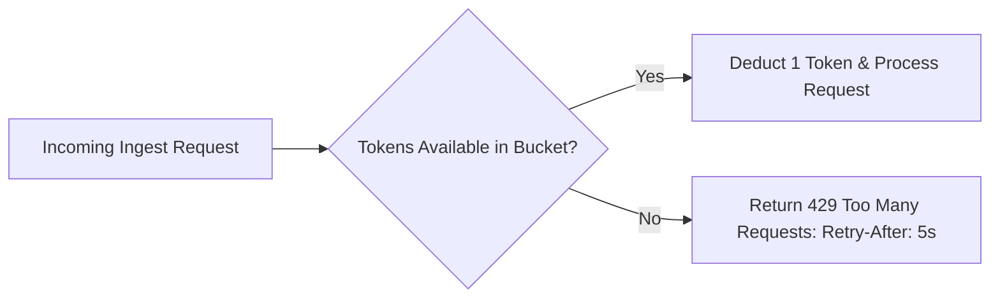

# 14.10 API Design & Rate Limiting

## 1. What It Is in Plain Words
Rate limiting restricts the number of requests a client can submit within a time window, protecting backend databases from denial-of-service traffic spikes.

---

## 2. How This Project Uses It
- **Token Bucket Algorithm**: Implemented in Redis, allowing burst traffic while enforcing sustained QPS limits per tenant API key.
- **Batch Endpoints**: `POST /v1/usage/events/batch` accepting up to 1,000 events to minimize HTTP connection overhead.

---

## 3. 30-Second Interview Answer
> "We enforce rate limiting using the Token Bucket algorithm stored in Redis. Each tenant is allocated a burst capacity of 1,000 tokens replenishing at 200 tokens per second. If a client exceeds their quota, the API returns a 429 Too Many Requests response with a Retry-After header, protecting database workers from runaway scripts."

