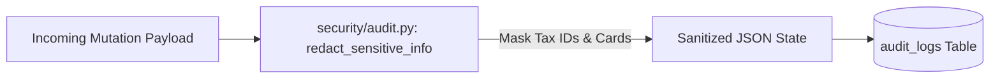

# 14.11 Security, Multi-Tenancy & SOX Compliance

## 1. What It Is in Plain Words
Security architecture protects sensitive financial data against unauthorized access, data exfiltration, and tampering. SOX compliance requires verifiable audit trails for all financial state changes.

---

## 2. How This Project Uses It
In `security/auth.py` and `security/audit.py`:
- **SHA-256 Hashed Keys**: Plaintext API keys are never stored.
- **Automated PII Scrubbing**: Recursive regex scrubbing redacts credit cards and tax IDs from audit logs.
- **Row-Level Tenant Isolation**: All queries explicitly filter by `tenant_id`.

---

## 3. 30-Second Interview Answer
> "Security is built on deny-by-default RBAC and immutable audit logging. API keys are hashed with SHA-256 before persistence, and all state mutations write to an append-only audit log. Before any audit log entry is saved, a recursive sanitizer automatically scrubs tax IDs, Social Security numbers, and credit card patterns to guarantee compliance with GDPR and SOC 2."

