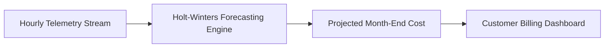

# 14.12 Search, Anomaly Detection & AI

## 1. What It Is in Plain Words
Search and predictive analytics help users query complex datasets and project future trends based on historical telemetry patterns.

---

## 2. How This Project Uses It
In `docs/07-ai-integration.md`:
- **Holt-Winters Spend Forecasting**: Predicts end-of-month invoice costs based on current month consumption acceleration.
- **LLM Dispute Copilot**: Uses RAG to ground natural language invoice dispute explanations in verified ledger entries.

---

## 3. 30-Second Interview Answer
> "We use Holt-Winters exponential smoothing to forecast month-end customer spend based on live consumption velocity. For customer support, we designed an LLM dispute assistant that uses RAG to retrieve exact line-item deltas and explain billing spikes in plain English, with strict guardrails preventing the model from altering ledger balances."

