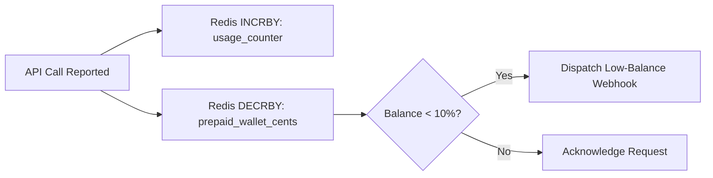

# 14.13 Real-Time Telemetry & Drawdowns

## 1. What It Is in Plain Words
Real-time systems process inputs and deliver outputs within strict, predictable latency deadlines—typically under 100 milliseconds.

---

## 2. How This Project Uses It
In `aggregation/counters.py`:
- **Sub-Second Drawdowns**: Redis atomic decrements (`DECRBY`) draw down prepaid customer balances as consumption occurs.
- **Low-Balance Alerts**: When balance drops below 10%, an automated webhook alert is triggered.

---

## 3. 30-Second Interview Answer
> "For customers on prepaid credit plans, we execute sub-second balance drawdowns using Redis atomic DECRBY operations. When an event is ingested, the rated cost is subtracted immediately in memory. If the remaining credit falls below a configurable threshold, the system dispatches an automated top-up webhook before service is interrupted."

