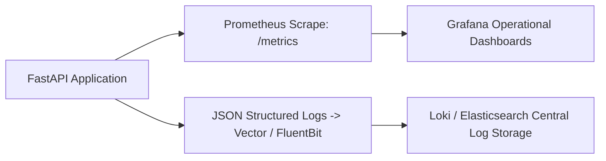

# 14.14 Observability & Operations

## 1. What It Is in Plain Words
Observability provides visibility into the internal state of a software system based on its external outputs: metrics, logs, and distributed traces.

---

## 2. How This Project Uses It
In `backend/src/observability/` and `security/audit.py`:
- **Metrics**: Prometheus exports for ingestion rate, rating latency percentiles, and ledger balance discrepancies.
- **Structured Logs**: JSON-formatted logs containing correlation IDs for end-to-end request tracing.

---

## 3. 30-Second Interview Answer
> "Observability is centered around Prometheus metrics and structured audit logs. We track four key golden signals: ingestion request rate, p95 rating latency, error rate, and a dedicated ledger balance gauge that triggers an immediate P0 alarm if any transaction fails debit-credit conservation."

