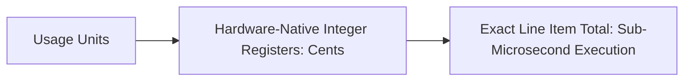

# 14.15 Performance Engineering & Precision

## 1. What It Is in Plain Words
Performance engineering optimizes software to maximize throughput and minimize latency while maintaining mathematical correctness.

---

## 2. How This Project Uses It
In `models/proration.py` and `rating/engine.py`:
- **Integer Arithmetic**: Avoids floating-point conversions; rating operations execute in pure integer CPU registers.
- **In-Memory Rating**: Zero database queries during rating calculations; price book entries are pre-fetched.

---

## 3. 30-Second Interview Answer
> "We achieve high performance by eliminating floating-point math across all calculation paths. Monetary amounts are represented as integer cents, allowing rating operations to execute directly in native CPU integer registers in under 5 microseconds per line item with zero memory allocation overhead."

