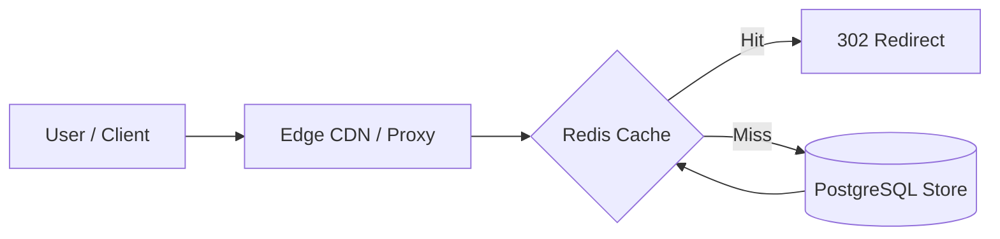

# 14.17 Classic System Design Problems

## 1. Designing AWS CloudWatch Billing
- **Requirements**: Ingest 100M telemetry metrics/sec; bill customers per metric alarm and metric stream.
- **Architecture**: Ingestion fronted by AWS Kinesis; continuous aggregation in Apache Flink; hourly aggregates committed to DynamoDB; billing period reconciliation queries pre-aggregated rollups.

---

## 2. Designing a High-Throughput URL Shortener
- **Requirements**: 10,000 writes/sec, 100,000 reads/sec.
- **Architecture**: Base62 encoding on distributed 64-bit sequence counters; Redis cache with LRU eviction for top 20% hot URLs; Cassandra / PostgreSQL backing store.

---

## 3. 30-Second Interview Answer
> "The building blocks of our billing engine—idempotent ingestion, sequence counter locking, and double-entry journals—apply directly to classic system design problems like AWS CloudWatch Billing or distributed rate limiters. In every case, the key is decoupling high-speed ingestion via streaming buffers from durable transactional storage."

