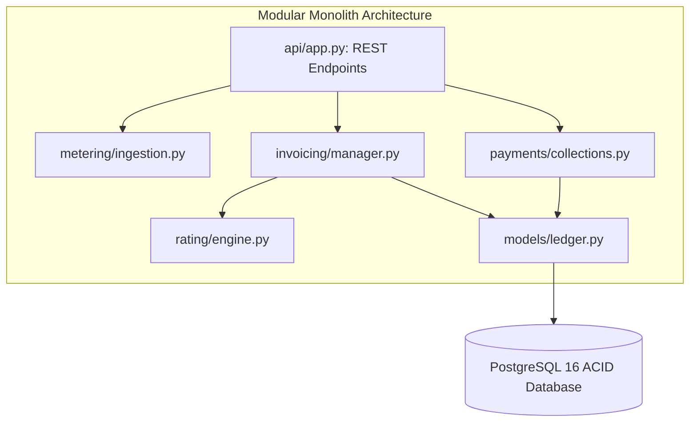

# 14.2 Architecture Styles & Ingestion Pipes

## 1. What It Is in Plain Words
Architecture style defines the coarse-grained structural organization of software: whether all components run in a single deployable unit (Monolith), separated domain boundaries within one deployable (Modular Monolith), independent network-separated services (Microservices), or ephemeral on-demand compute (Serverless).

---

## 2. How This Project Uses It
In `backend/src/`:
- **Current Style**: **Modular Monolith**.
- Distinct business modules (`metering/`, `rating/`, `invoicing/`, `models/ledger.py`, `payments/`) are strictly isolated with explicit domain interfaces, while sharing an asynchronous PostgreSQL database connection pool.
- This style was chosen because financial billing operations—such as finalizing an invoice and posting double-entry ledger entries—require ACID transaction guarantees that cannot be maintained across distributed microservices without complex two-phase commit protocols.

---

## 3. Comparison of Architecture Styles

| Factor | Modular Monolith [This Project] | Distributed Microservices | Serverless (AWS Lambda) |
| :--- | :--- | :--- | :--- |
| **Transactional Integrity** | **Strict ACID across all tables** | Eventual consistency / 2PC | Eventual consistency |
| **Operational Overhead** | **Low (single container/process)** | High (Kubernetes, mesh, tracing)| Moderate (Cold starts, IAM) |
| **Deployment Complexity** | **Atomic single-command deploy** | Independent multi-pipeline | Independent function deploys |
| **Network Latency** | **In-memory local function calls** | HTTP / gRPC hop latency | Cold start + network latency |
| **Scaling Flexibility** | Scale entire process | Independent service scaling | Infinite autoscaling |

- **Why I Used Modular Monolith**: Preserves ACID transactions during billing reconciliation without distributed lock complexity [CONFIRM WITH DEVELOPER].
- **Why I Did Not Use Microservices**: Splitting the ledger from invoicing would require a distributed Saga pattern, drastically increasing failure modes.

---

## 4. What Breaks First at Scale
At 100x scale, high-frequency telemetry ingestion begins competing with heavy end-of-month aggregation queries for CPU and connection pool slots.
- **Senior Engineer Remediation**: Extract `metering/ingestion.py` into a dedicated high-throughput *Ingestion Microservice* communicating asynchronously with the billing core via Kafka.

---

## 5. 30-Second Interview Answer
> "I architected 19-Usage-Billing-Engine as a modular monolith. This gives us clear domain separation between metering, rating, and invoicing while allowing ledger entries and invoice finalizations to execute within the same atomic ACID database transaction. Under extreme scale, I would decouple the telemetry ingestion pipeline into an independent event streaming service while keeping the financial accounting core strictly transactional."

