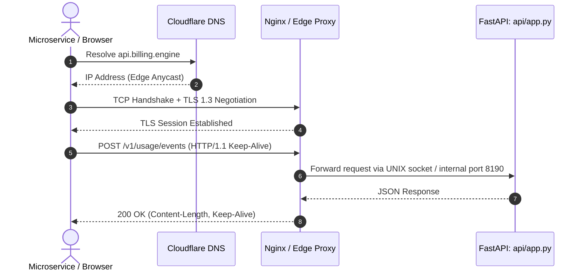

# 14.3 Networking & Communication Protocols

## 1. What It Is in Plain Words
Networking defines the physical and protocol transport layers over which clients submit requests and services communicate: DNS resolution, TLS encryption handshakes, reverse proxy routing, and protocol choices (HTTP/1.1 vs HTTP/2/3, REST vs gRPC).

---

## 2. How This Project Uses It
In `backend/src/api/app.py`:
- **Protocol**: HTTP/1.1 with JSON payloads.
- **Security**: TLS 1.3 terminated at edge reverse proxy (Cloudflare / Nginx).
- **CORS**: Starlette `CORSMiddleware` configured with allowed headers and methods.

---

## 3. Protocol Comparison

| Factor | REST / HTTP/1.1 [This Project] | gRPC / HTTP/2 | GraphQL | WebSockets |
| :--- | :--- | :--- | :--- | :--- |
| **Payload Format** | **Human-readable JSON** | Binary Protocol Buffers | JSON query string | Arbitrary frames |
| **Multiplexing** | Sequential per TCP connection | Full stream multiplexing | Sequential over HTTP | Bi-directional streams |
| **Network Overhead**| Moderate (text headers & JSON) | Extremely low (compressed bin) | Moderate | Very low |
| **Browser Compatibility**| Universal native support | Requires grpc-web proxy | Universal | Native WebSocket API |

- **Why I Used REST**: Zero client dependencies; allows any microservice (cURL, Python, Go, Node) to report usage instantly [CONFIRM WITH DEVELOPER].
- **Why I Did Not Use gRPC**: Requires sharing compiled `.proto` stubs with all tenant developers.

---

## 4. 30-Second Interview Answer
> "We use RESTful HTTP/1.1 with JSON payloads and TLS 1.3 termination. This ensures universal compatibility across diverse programming languages and microservices without requiring compiled Protocol Buffer stubs. For high-frequency internal telemetry at 100x scale, I would introduce gRPC to leverage HTTP/2 stream multiplexing and binary compression to reduce network bandwidth by up to 60%."

