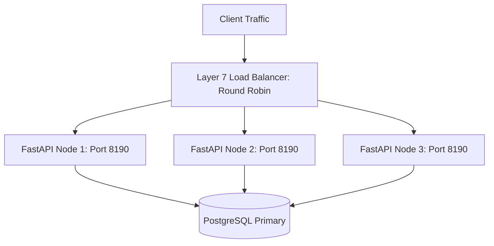

# 14.4 Load Balancing & Scaling

## 1. What It Is in Plain Words
Load balancing distributes incoming client traffic across multiple backend server instances to prevent any single server from becoming overwhelmed. Scaling expands capacity vertically (larger machines) or horizontally (adding more instances).

---

## 2. How This Project Uses It
- **Stateless API Nodes**: `api/app.py` instances store zero in-memory session state; any node can process any ingestion event or invoice request.
- **Tenant Hashing**: Load balancers route requests based on `X-Tenant-ID` header hash or round-robin algorithms.

---

## 3. Single Points of Failure & Remediation
1. **PostgreSQL Primary Database**: If the primary crashes, writes halt. *Fix*: AWS RDS Multi-AZ automated failover with standby replica in secondary availability zone.
2. **Invoice Sequence Counter**: Row-level locking on sequence records serializes concurrent finalizations. *Fix*: Allocate pre-fetched blocks of 100 sequence numbers per worker process.

---

## 4. 30-Second Interview Answer
> "Our FastAPI application nodes are 100% stateless, allowing horizontal autoscaling behind a Layer 7 load balancer using round-robin distribution. Single points of failure are mitigated by deploying PostgreSQL in a Multi-AZ active-standby configuration with automatic 60-second failover and read replicas for dashboard analytics."

