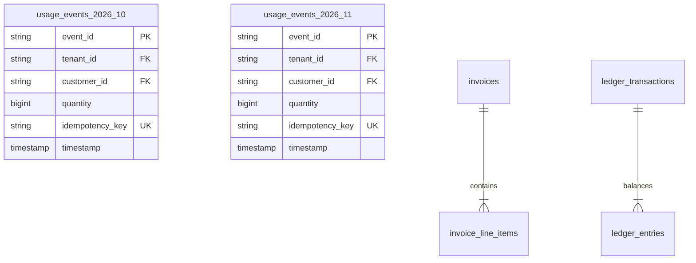

# 14.5 Databases & Storage

## 1. What It Is in Plain Words
Databases store and manage persistent application records. Storage architectures balance read/write throughput, durability guarantees, indexing mechanisms, and partitioning strategies.

---

## 2. How This Project Uses It
In `backend/src/models/`:
- **PostgreSQL 16**: Declarative range partitioning on `usage_events` by month.
- **Indexes**: Composite unique B-tree index on `(tenant_id, idempotency_key)` in `events.py:L29`; composite index on `(tenant_id, customer_id, timestamp)` for rollups.
- **Check Constraints**: `quantity >= 0` and `amount_cents > 0`.

---

## 3. 30-Second Interview Answer
> "We use PostgreSQL 16 with monthly range partitioning on the usage events table. This prevents B-tree index degradation as data scales into hundreds of millions of rows, because queries filtering by date range scan only the relevant monthly partition. All monetary balances are stored as SQL BIGINT integer cents, and database check constraints guarantee that negative quantities can never enter the ledger."

