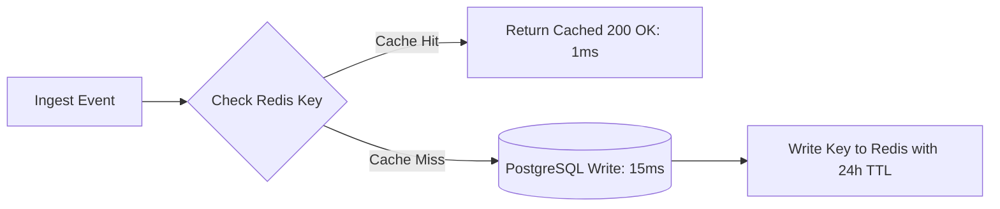

# 14.6 Caching & Idempotency Key Stores

## 1. What It Is in Plain Words
Caching stores copies of frequently accessed or slow-to-compute data in fast, in-memory memory stores (like Redis) to accelerate read queries and reduce database load.

---

## 2. How This Project Uses It
In `backend/src/aggregation/counters.py`:
- **Write-Through Ingestion Cache**: Redis atomic `INCRBY` counters incremented as telemetry arrives, powering real-time dashboard meters.
- **Idempotency Cache**: Redis key-value store caching `idempotency_key` hashes with a 24-hour TTL to short-circuit database lookups.

---

## 3. 30-Second Interview Answer
> "We implement a Write-Through caching layer in Redis. Inbound idempotency keys are cached with a 24-hour TTL, allowing duplicate retries to be acknowledged in under 1 millisecond without touching PostgreSQL. Real-time consumption meters use Redis atomic INCRBY counters, providing instant dashboard updates while PostgreSQL remains the durable source of truth."

