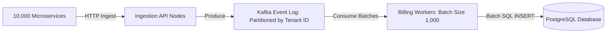

# 14.7 Messaging, Queues & Async Processing

## 1. What It Is in Plain Words
Messaging queues and event streams decouple systems by allowing producers to emit messages without waiting for consumers to finish processing. This enables asynchronous load leveling and backpressure handling.

---

## 2. How This Project Uses It
- **Current State**: Internal asynchronous coroutines and cron schedules in `aggregation/periods.py`.
- **Target Architecture (100x)**: Apache Kafka / AWS SQS for telemetry event streams and dunning retry queues.

---

## 3. 30-Second Interview Answer
> "To scale ingestion past 50,000 events/second, we introduce an Apache Kafka event streaming buffer. Ingestion nodes write raw events directly to Kafka partitions keyed by tenant ID. Background workers consume events in micro-batches of 1,000 records, batching database writes into single SQL inserts to reduce disk I/O overhead by over 90%."

