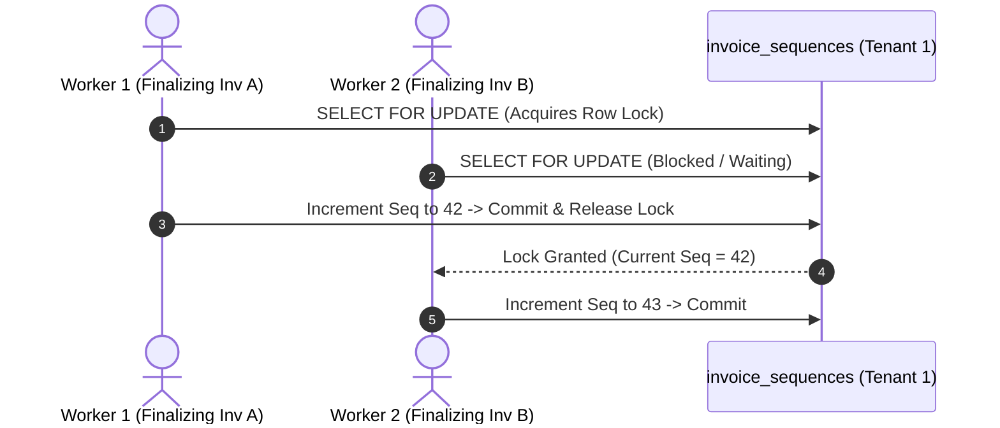

# 14.8 Consistency, Concurrency & Locking

## 1. What It Is in Plain Words
Concurrency control ensures that multiple transactions executing at the same time do not leave data in an inconsistent or corrupted state (race conditions, phantom reads, dirty writes).

---

## 2. How This Project Uses It
In `invoicing/manager.py:L245-L260` and `models/ledger.py:L75-L99`:
- **Row-Level Locking**: `SELECT ... FOR UPDATE` on `invoice_sequences` guarantees sequential legal numbering without number skipping.
- **Double-Entry Invariants**: $\sum \text{Debits} == \sum \text{Credits}$ enforced within atomic transactions.

---

## 3. 30-Second Interview Answer
> "We prevent race conditions in legal invoice numbering by acquiring an exclusive row-level lock on sequence records using SELECT ... FOR UPDATE. This guarantees gapless numbering even under heavy concurrent finalizations. For financial integrity, every ledger transaction enforces debit-credit equality before committing to the database."

