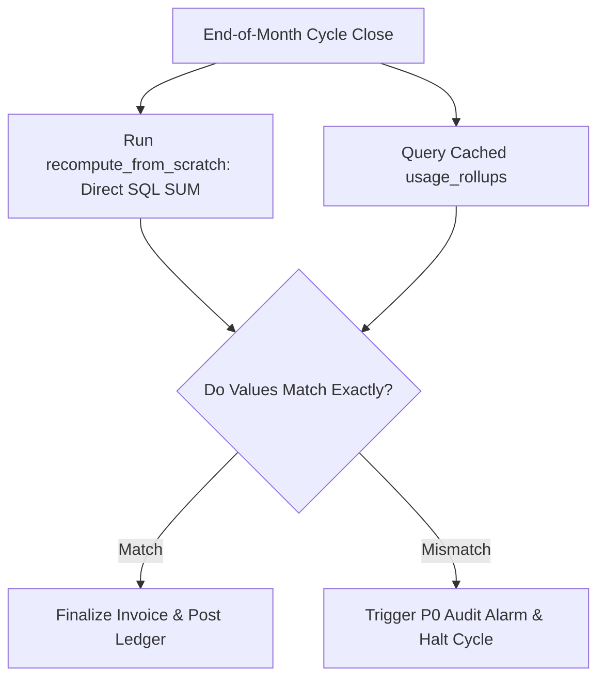

# 14.9 Reliability, Resilience & Reconciliation

## 1. What It Is in Plain Words
Reliability is the probability that a system performs its required functions under specified conditions. Resilience is the system's ability to absorb failures (network partitions, hardware crashes) and recover automatically.

---

## 2. How This Project Uses It
In `aggregation/periods.py:L130`:
- **Differential Reconciliation**: End-of-cycle audits compare pre-aggregated rollups with raw event SQL sums (`recompute_from_scratch`).
- **Payment Retries with Backoff**: Dunning retries at Day 0, 3, 7, and 14 with grace period tracking.

---

## 3. 30-Second Interview Answer
> "We ensure financial resilience through automated differential reconciliation. Before closing any billing period, our worker computes a from-scratch SQL sum across all raw usage events and compares it against pre-aggregated rollups. If a discrepancy of even one cent is detected, the cycle halts and alerts engineering, preventing corrupt invoices from reaching customers."

